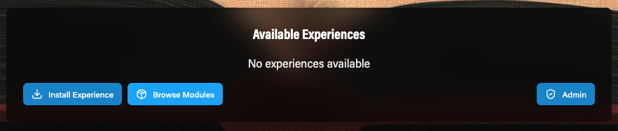
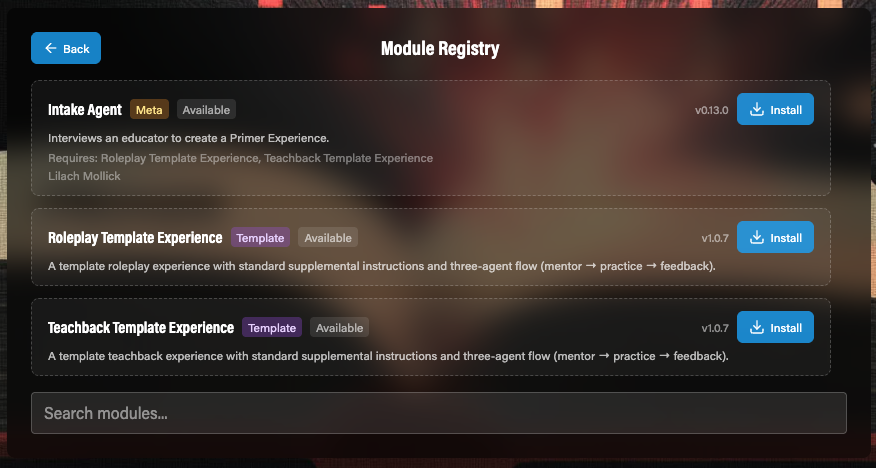
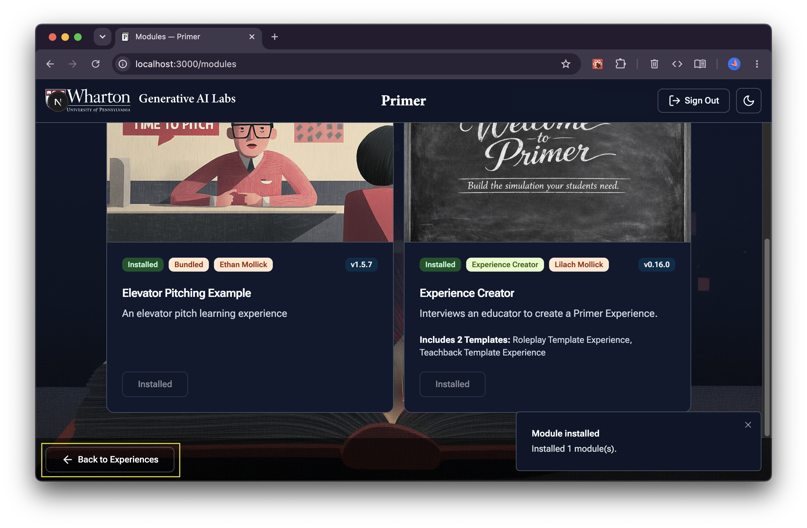

# Primer

**Primer** is an experimental platform for creating interactive AI experiences that combine voice, visuals, and autonomous decision-making. Think of it as a runtime that plays "experiences" - self-contained interactive scenarios where AI agents can talk with you using realistic voice, display contextual images and scenes, make autonomous decisions about what happens next, and use various tools like showing notes, generating images, or searching the web.

Each experience is defined by a configuration file that specifies the AI agents involved (their personalities, voices, instructions), visual scenes and sound effects, how agents flow from one to another, and what tools they can use. It's essentially a framework for creating rich, multi-modal AI interactions that go beyond simple chat - more like interactive AI-driven experiences or games.

## Deploy Your Own Instance

 

| Platform | Storage | Post-deploy setup |
|----------|---------|-------------------|
| Heroku | Ephemeral (data lost on restart) | Set `NEXTAUTH_URL` + Google OAuth config |
| Render | Persistent disk available | Set `NEXTAUTH_URL` + Google OAuth config |

### Prerequisites

Before deploying, have these credentials ready:

#### 1. OpenAI API Key (Required)

1. Go to [platform.openai.com/api-keys](https://platform.openai.com/api-keys)
2. Sign in or create an account
3. Click **Create new secret key**
4. Configure the key:
   - **Owned by**: Select **You**
   - **Name**: Give it a descriptive name (e.g., "primer")
   - **Project**: Select **Default project** (or your preferred project)
   - **Permissions**: Select **All**
5. Click **Create secret key**
6. Copy and save the key securely (starts with `sk-proj-...`) — you won't be able to see it again

> **Note:** Primer uses the Realtime API, which requires a funded OpenAI account with access to GPT-4 models.

#### 2. Google OAuth Credentials (Required)

These enable user authentication via Google sign-in.

**Step A: Create OAuth credentials (before deploying)**

1. Go to [Google Cloud Console](https://console.cloud.google.com/)
2. Click the **project selector dropdown** at the top-left of the page (next to "Google Cloud")
3. In the modal that appears, click **New Project** in the top-right
4. Enter a project name (e.g., "Primer") and click **Create**
5. Make sure your new project is selected in the project selector dropdown
6. Navigate to **APIs & Services** → **Credentials** (use the left sidebar or search bar)
7. Click **Create Credentials** → **OAuth client ID**
8. If prompted to configure the OAuth consent screen first:
   - User Type: Select **External**, then click **Create**
   - App name: "Primer" (or your preference)
   - User support email: Select your email
   - Developer contact information: Enter your email
   - Click **Save and Continue** through the remaining steps (Scopes, Test Users) — defaults are fine
9. Back on **Credentials**, click **Create Credentials** → **OAuth client ID**
10. Configure the OAuth client:
    - Application type: **Web application**
    - Name: "Primer"
    - Leave redirect URIs empty for now (you'll add them after deployment)
11. Click **Create**
12. Copy the **Client ID** and **Client Secret** — you'll need these during deployment

**Step B: Complete setup after deployment**

After deploying, you'll receive your app URL. Complete these steps to enable authentication:

<strong>Heroku post-deploy steps</strong>

1. **Set NEXTAUTH_URL in Heroku:**
   - Go to your Heroku app dashboard → **Settings** → **Config Vars**
   - Click **Reveal Config Vars**
   - Add `NEXTAUTH_URL` with your app URL (e.g., `https://your-app-name.herokuapp.com`)

2. **Configure Google Cloud Console:**
   - Go to [Google Cloud Console → Credentials](https://console.cloud.google.com/apis/credentials)
   - Click on your OAuth client ID to edit it
   - Under **Authorized JavaScript origins**, add:
     - `https://your-app-name.herokuapp.com`
   - Under **Authorized redirect URIs**, add:
     - `https://your-app-name.herokuapp.com/api/auth/callback/google`
   - Click **Save**

3. **Restart the Heroku dyno:**
   - Go to your Heroku app dashboard → **More** → **Restart all dynos**
   - Or run: `heroku restart -a your-app-name`

<strong>Render post-deploy steps</strong>

1. **Set NEXTAUTH_URL in Render:**
   - Go to your Render dashboard → select your service → **Environment**
   - Add `NEXTAUTH_URL` with your app URL (e.g., `https://your-app-name.onrender.com`)

2. **Configure Google Cloud Console:**
   - Go to [Google Cloud Console → Credentials](https://console.cloud.google.com/apis/credentials)
   - Click on your OAuth client ID to edit it
   - Under **Authorized JavaScript origins**, add:
     - `https://your-app-name.onrender.com`
   - Under **Authorized redirect URIs**, add:
     - `https://your-app-name.onrender.com/api/auth/callback/google`
   - Click **Save**

3. **Redeploy** your Render service to apply the environment variable changes

> **Important:** Google sign-in will not work until you complete the post-deploy steps for your platform. The app will deploy successfully, but authentication will fail until redirect URIs are configured in Google Cloud Console.

#### 3. Anthropic API Key (Optional)

For experiences that use Claude models:

1. Go to [console.anthropic.com](https://console.anthropic.com/)
2. Sign in or create an account
3. Navigate to **API Keys**
4. Create a new key and copy it

## Key Features

This experimental version demonstrates:
- Realtime voice interaction (via OpenAI's Realtime API)
- Agent sequencing and branching
- Personality prompting
- Autonomous decision making to create experiences (choosing scenes and sounds)
- Plugin-based tool system for extensible capabilities

## Local Development Setup

For full step-by-step instructions to get Primer running locally, see the [Developer Setup Guide](https://primer-docs.onrender.com/developer/setup).

### Advanced Configuration

For custom domains or multi-domain setups, you may need these additional environment variables:

- `NEXT_PUBLIC_SOCKET_SERVER_URL` - Your app URL (e.g., `https://your-app.onrender.com`)
- `ALLOWED_ORIGINS` - Comma-separated list of allowed CORS origins for Socket.IO (e.g., `https://your-app.onrender.com,https://www.yourdomain.com`). If not set, automatically derived from `NEXT_PUBLIC_SOCKET_SERVER_URL`.

> **Note:** The Socket.IO server uses CORS allowlist for security. If you have multiple domains accessing your app, set `ALLOWED_ORIGINS` with all allowed origins.

## Installing Modules

Primer ships without any experiences pre-installed. Modules are self-contained experiences (templates, tools, agents) that you can browse and install directly from within Primer.

### Step 1: Open the Module Registry

After signing in, the Experience Catalog will show "No experiences available." Click **Browse Modules** to open the Module Registry.

### Step 2: Install Modules

The Module Registry shows all available modules from the configured registry. Click **Install** on any module to download and install it. Dependencies are resolved automatically -- for example, installing the Intake Agent will also install the Roleplay and Teachback templates it requires.

### Step 3: Ready to Go

Once installed, modules appear in the Experience Catalog and are ready to use. Installed modules show a green "Installed" badge in the registry.

### Available Modules

| Module | Kind | Description |
|--------|------|-------------|
| **Intake Agent** | Meta | Interviews an educator to create a new Primer Experience. Requires the Roleplay and Teachback templates. |
| **Roleplay Template** | Template | A roleplay experience with mentor, practice, and feedback agents. |
| **Teachback Template** | Template | A teachback experience with mentor, practice, and feedback agents. |

### Custom Module Registries

To use a custom module registry (or add additional registries), set the `MODULE_REGISTRY_URLS` environment variable to a comma-separated list of manifest URLs. For private registries hosted on GitHub, also set `MODULE_REGISTRY_TOKEN` to a fine-grained Personal Access Token with Contents: Read-only permission.

### Defining your own Primer project
You should be able to use this repo to run your own Primer projects:
- Publish a experience.json with relative or absolute URLs to assets, includes and agent instructions.
- Publish the assets, includes and agent instructions.
  - Eventually, Primer itself (Primer Compose) will create these configurations.
  - For now, copy the file and folder structure within the config folder and modify the files appropriately.

## UI
Start your Experience by entering the URL of:
- an Experience config file, with links to resources;  
- a zip file, containing an Experience config file, and resources.

## Config Structure
Experiences are self-contained. See the Developer Setup Guide for experience specification details.

## Documentation

- **[CHANGELOG.md](CHANGELOG.md)** - Version history and recent changes
- **[CONTRIBUTING.md](CONTRIBUTING.md)** - How to contribute to the project

## Development Process & Acknowledgments
This project was developed through human-AI pair programming, with architectural and refactoring decisions made in collaboration with Claude (Anthropic).

We gratefully acknowledge design and code contributions from [Lincoln Loop](https://lincolnloop.com/), and the example realtime API project by [OpenAI](https://github.com/openai/openai-realtime-agents).

## Contact

For questions, security issues, or other inquiries, contact the Wharton Generative AI Labs team at **genailab@wharton.upenn.edu**.

## Licenses
This project is licensed under the MIT License. See [LICENSE](LICENSE).  
This software uses third-party libraries or other resources that may be distributed under different licenses. See the [NOTICES.md](NOTICES.md) file for details and third-party licenses.