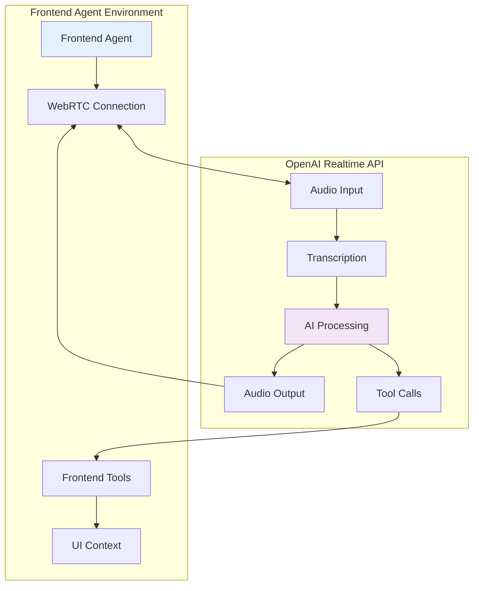
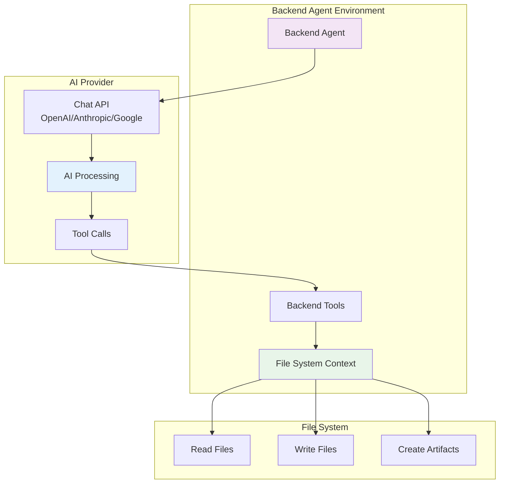
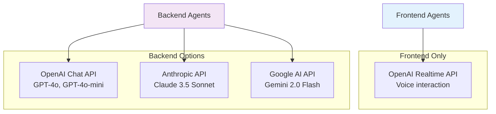
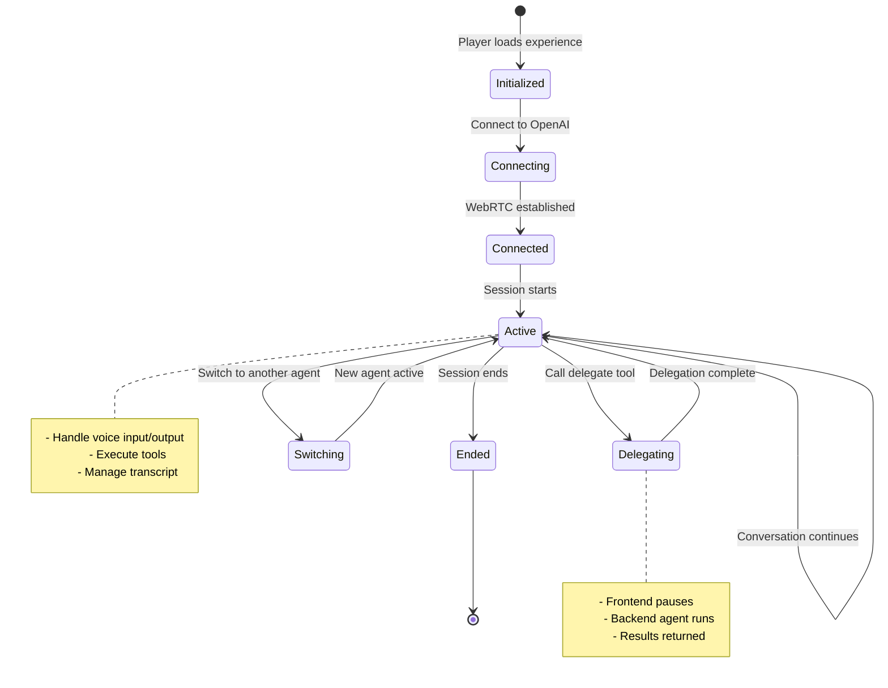
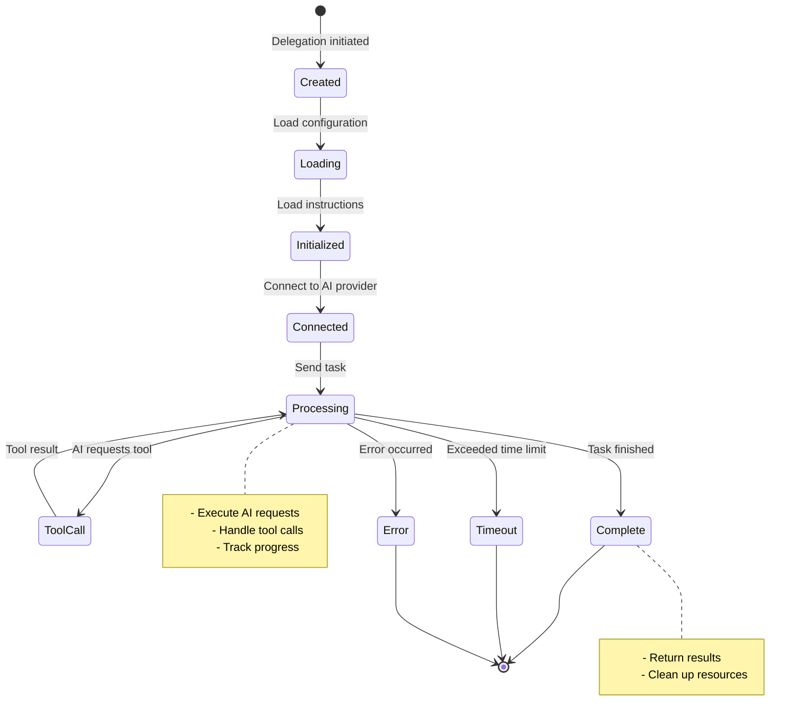
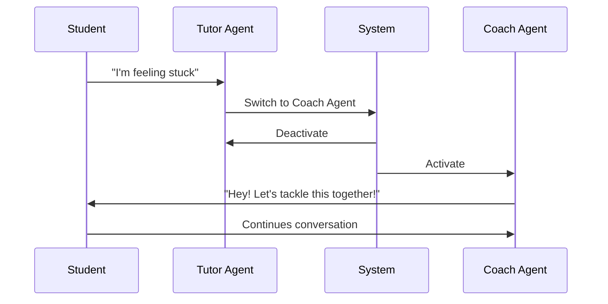
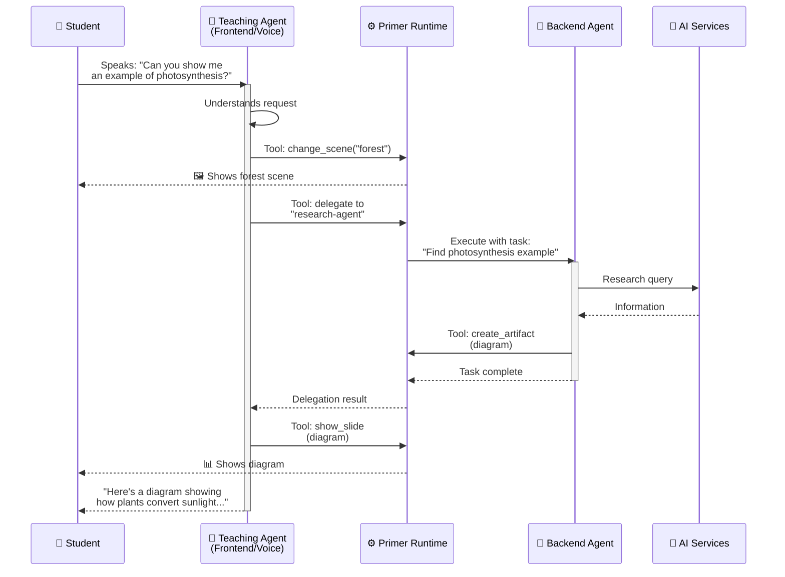

# Agent Architecture

Primer's dual-agent architecture is a key innovation that separates real-time voice interaction from complex processing tasks. This document explains how agents work, how they're configured, and how they coordinate.

---

## Agent Types

### Frontend Agents (Voice/Realtime)

Frontend agents handle real-time voice interaction with students using the OpenAI Realtime API.



**Key Characteristics**:
- **Real-time**: Immediate audio streaming
- **Single active agent**: Only one frontend agent at a time
- **Voice-first**: Optimized for natural conversation
- **UI access**: Can manipulate visual elements
- **Delegation capable**: Can hand off to backend agents

**Configuration Example**:
```json
{
  "name": "Friendly Tutor",
  "type": "frontend",
  "voice": "nova",
  "publicDescription": "A helpful learning assistant",
  "toolGroups": ["builtin", "notes", "slide", "sound"],
  "downstreamAgents": ["research-agent", "quiz-agent"],
  "aiConfiguration": "default"
}
```

---

### Backend Agents (Processing/Complex Tasks)

Backend agents handle complex processing without interrupting voice conversation.



**Key Characteristics**:
- **Asynchronous**: Runs in background
- **Multiple concurrent**: Several can run at once
- **File access**: Direct file system operations
- **No voice**: Text-based only
- **Provider flexible**: OpenAI, Anthropic, or Google

**Configuration Example**:
```json
{
  "name": "Research Agent",
  "type": "backend",
  "publicDescription": "Researches topics and finds examples",
  "toolGroups": ["builtin", "web-search", "artifact"],
  "aiConfiguration": "backend-claude",
  "temperature": 0.7
}
```

---

## Agent Configuration

### Required Fields

| Field | Type | Description |
|-------|------|-------------|
| `name` | string | Human-readable agent name |
| `type` | "frontend" \| "backend" | Agent type |
| `publicDescription` | string | What students see (optional for backend) |
| `toolGroups` | string[] | Available tool groups |
| `aiConfiguration` | string | References aiConfigurations key |

### Frontend-Specific Fields

| Field | Type | Description |
|-------|------|-------------|
| `voice` | string | OpenAI voice (alloy, echo, fable, onyx, nova, shimmer) |
| `downstreamAgents` | string[] | Backend agents this can delegate to |
| `instructions` | string | Inline instructions (or use file) |
| `instructionsFile` | string | Path to instruction file |
| `turnDetection` | object | Voice activity detection settings |

### Backend-Specific Fields

| Field | Type | Description |
|-------|------|-------------|
| `temperature` | number | AI temperature (0-2) |
| `maxTokens` | number | Maximum response length |
| `topP` | number | Nucleus sampling parameter |

---

## Instruction System

### Instruction Sources

Agents can get instructions from three sources (priority order):

1. **Inline instructions** (highest priority)
2. **Instruction file** (agent-specific)
3. **Supplemental files** (shared across agents)

```mermaid
graph LR
    AGENT[Agent Config]

    INLINE[Inline Instructions<br/>in experience.json]
    FILE[Agent File<br/>instructions/agent/{key}.txt]
    SUPP[Supplemental Files<br/>instructions/supplemental/]

    AGENT -.->|1. Check| INLINE
    AGENT -.->|2. Check| FILE
    AGENT -.->|3. Include| SUPP

    FINAL[Final Instructions]

    INLINE --> FINAL
    FILE --> FINAL
    SUPP --> FINAL

    style INLINE fill:#e3f2fd
    style FILE fill:#f3e5f5
    style SUPP fill:#e8f5e9
```

### Instruction File Format

**Location**: `storage/{experienceId}/resources/instructions/agent/{agentKey}.txt`

**Example** (`tutor.txt`):
```
You are a friendly physics tutor helping students understand complex concepts.

Your teaching style:
- Start with the big picture before diving into details
- Use real-world examples and analogies
- Ask questions to check understanding
- Encourage students when they struggle
- Break complex topics into digestible pieces

Available tools:
- scene: Change background images to match topics
- slide: Show diagrams and visual explanations
- notes: Display key points as sticky notes
- sound: Play audio to enhance learning
- delegate: Ask research-agent to find examples

Remember: Students learn best when engaged, so make learning interactive!
```

### Placeholder Variables

Instructions support placeholder variables replaced at runtime:

| Placeholder | Replaced With |
|-------------|---------------|
| `{{experience_name}}` | Experience title |
| `{{experience_description}}` | Experience description |
| `{{user_name}}` | Student's name |
| `{{available_scenes}}` | List of available scenes |
| `{{available_sounds}}` | List of available sounds |
| `{{downstream_agents}}` | List of agents to delegate to |

**Example**:
```
You are teaching {{experience_name}}.

The learning objective is: {{experience_description}}

The student's name is {{user_name}}.

You can delegate to these specialists: {{downstream_agents}}
```

---

## AI Provider Configuration

### Configuration Schema

```json
{
  "aiConfigurations": {
    "default": {
      "provider": "openai-realtime",
      "model": "gpt-4o-realtime-preview",
      "temperature": 0.8,
      "apiKey": "env:OPENAI_API_KEY"
    },
    "backend-claude": {
      "provider": "anthropic",
      "model": "claude-3-5-sonnet-20241022",
      "temperature": 0.7,
      "apiKey": "env:ANTHROPIC_API_KEY"
    },
    "backend-gemini": {
      "provider": "google",
      "model": "gemini-2.0-flash-exp",
      "temperature": 0.7,
      "apiKey": "env:GOOGLE_AI_API_KEY"
    }
  }
}
```

### Supported Providers



### Provider Comparison

| Provider | Best For | Strengths | Limitations |
|----------|----------|-----------|-------------|
| **OpenAI Realtime** | Voice interaction | Real-time audio, low latency | Frontend only, more expensive |
| **OpenAI Chat** | General backend tasks | Fast, reliable, well-documented | Cost per token |
| **Anthropic** | Complex reasoning | Long context, analysis | Slightly slower |
| **Google** | Cost-effective | Fast, affordable | Newer, less proven |

---

## Agent Context

### Frontend Context

Frontend agents receive a context object with UI capabilities:

```typescript
interface FrontendContext {
  // Identifiers
  experienceId: string;
  sessionId: string;

  // Available resources
  availableScenes: Record<string, {
    name: string;
    path: string;
    url: string;
  }>;
  availableSounds: Record<string, {
    name: string;
    path: string;
    url: string;
  }>;

  // UI functions
  setScene: (name: string) => void;
  playSound: (name: string, options?: SoundOptions) => void;
  showNote: (content: string, position?: Position) => void;
  showSlide: (content: string) => void;
  showMermaid: (diagram: string) => void;

  // State management
  getInformation: (key: string) => any;
  saveInformation: (key: string, value: any) => void;
  listInformation: () => string[];

  // Delegation
  delegate: (agentName: string, task: string) => Promise<string>;
}
```

**Usage Example**:
```typescript
// Tool handler in frontend context
async function handleSceneChange(args, context: FrontendContext) {
  const { name } = args;

  if (!context.availableScenes[name]) {
    return {
      success: false,
      error: `Scene "${name}" not found`
    };
  }

  context.setScene(name);

  return {
    success: true,
    result: `Scene changed to ${name}`
  };
}
```

---

### Backend Context

Backend agents receive a context with direct file access:

```typescript
interface BackendContext {
  // Identifiers
  experienceId: string;
  sessionId: string;
  delegationId?: string;

  // User info
  userInfo?: {
    name: string;
    email: string;
  };

  // File operations
  readFile: (path: string) => Promise<string>;
  writeFile: (path: string, content: string) => Promise<void>;
  deleteFile: (path: string) => Promise<void>;
  listFiles: (path: string) => Promise<string[]>;
  fileExists: (path: string) => Promise<boolean>;

  // Artifact operations
  listArtifacts: () => Promise<Artifact[]>;
  getArtifact: (id: string) => Promise<Artifact | null>;
  createArtifact: (name: string, content: string, type: string) => Promise<string>;
  updateArtifact: (id: string, content: string) => Promise<void>;
  deleteArtifact: (id: string) => Promise<void>;

  // Experience operations
  getExperienceConfig: () => Promise<ExperienceConfig>;
  updateExperienceConfig: (updates: Partial<ExperienceConfig>) => Promise<void>;
}
```

**Usage Example**:
```typescript
// Tool handler in backend context
async function analyzeSession(args, context: BackendContext) {
  // Read transcript
  const transcript = await context.readFile(
    `session_data/sess_${context.sessionId}/transcript.json`
  );

  const data = JSON.parse(transcript);

  // Analyze conversation
  const analysis = performAnalysis(data);

  // Create report artifact
  const artifactId = await context.createArtifact(
    "Session Analysis",
    JSON.stringify(analysis, null, 2),
    "json"
  );

  return {
    success: true,
    result: `Analysis complete. Artifact: ${artifactId}`
  };
}
```

---

## Agent Lifecycle

### Frontend Agent Lifecycle



### Backend Agent Lifecycle



---

## Agent Switching

Frontend agents can switch to other frontend agents during a session.



**Configuration**:
```json
{
  "agents": {
    "tutor": {
      "type": "frontend",
      "downstreamAgents": ["coach"],
      "toolGroups": ["builtin", "agent"]
    },
    "coach": {
      "type": "frontend",
      "toolGroups": ["builtin", "celebrate"]
    }
  }
}
```

**Tool Call**:
```json
{
  "tool": "agent",
  "args": {
    "action": "switch",
    "name": "coach"
  }
}
```

---

## Agent Delegation

Frontend agents can delegate complex tasks to backend agents while continuing to interact with students.

### Example: Frontend-Backend Coordination

This sequence diagram shows how a frontend teaching agent delegates research and content creation to backend agents:



**Key Benefits**:
- Frontend agent maintains continuous voice conversation
- Backend agents handle time-intensive tasks
- Students don't experience awkward pauses
- Specialized agents produce higher-quality results

**See also**: [Delegation Guide](./delegation.md) for detailed patterns and best practices.

---

## Best Practices

### Frontend Agent Design

**Do**:
- ✅ Keep instructions focused on conversation
- ✅ Use delegate for complex tasks
- ✅ Provide clear public descriptions
- ✅ Test voice interaction thoroughly
- ✅ Use appropriate voice for personality

**Don't**:
- ❌ Put complex processing in frontend agents
- ❌ Use frontend agents for file operations
- ❌ Overload with too many tools
- ❌ Create very long instructions
- ❌ Forget to test audio quality

### Backend Agent Design

**Do**:
- ✅ Specialize agents for specific tasks
- ✅ Use appropriate AI provider for task
- ✅ Provide clear delegation instructions
- ✅ Handle errors gracefully
- ✅ Return concise results

**Don't**:
- ❌ Make backend agents too general
- ❌ Forget timeout considerations
- ❌ Return huge amounts of data
- ❌ Use backend agents for simple tasks
- ❌ Ignore context limits

### Instruction Writing

**Do**:
- ✅ Be specific about behavior
- ✅ Include examples
- ✅ Explain available tools
- ✅ Define personality clearly
- ✅ Use placeholders for dynamic content

**Don't**:
- ❌ Write overly long instructions
- ❌ Contradict tool capabilities
- ❌ Forget to mention delegation options
- ❌ Use vague language
- ❌ Ignore the student perspective

---

## Troubleshooting

### Common Issues

| Issue | Symptom | Solution |
|-------|---------|----------|
| Agent not responding | No voice output | Check WebRTC connection, API key |
| Tools not working | Tool calls fail | Verify tool group assignment |
| Delegation timeout | Backend agent doesn't return | Increase timeout, simplify task |
| Wrong voice | Unexpected voice | Check voice configuration |
| Instructions ignored | Agent behaves differently | Check instruction file loading |

### Debugging Tips

1. **Check ConfigLoader validation**: Look for warnings/errors
2. **Review transcript**: See what AI is actually receiving
3. **Test tools independently**: Verify tool execution
4. **Monitor API usage**: Check for rate limits, quotas
5. **Read logs**: Server logs show delegation status

---

## Advanced Topics

### Custom Turn Detection

Fine-tune voice activity detection:

```json
{
  "turnDetection": {
    "type": "server_vad",
    "threshold": 0.5,
    "prefix_padding_ms": 300,
    "silence_duration_ms": 500
  }
}
```

### Temperature Tuning

Adjust creativity vs. consistency:

- **Low (0.0-0.3)**: Consistent, predictable, factual
- **Medium (0.4-0.7)**: Balanced, natural conversation
- **High (0.8-1.0)**: Creative, varied, exploratory

### Multi-Modal Capabilities

Backend agents can process uploaded files:

```typescript
// Student uploads PDF
const content = await context.readFile(uploadedFilePath);
const analysis = await analyzeDocument(content);
await context.createArtifact("Summary", analysis, "markdown");
```

---

## Next Steps

- [Delegation](./delegation.md) - Deep dive on delegation system
- [Tools System](./tools-system.md) - Available tools and creation
- [Data Flows](./data-flows.md) - How data moves between agents
- [Experience Format](./experience-format.md) - Complete configuration reference
