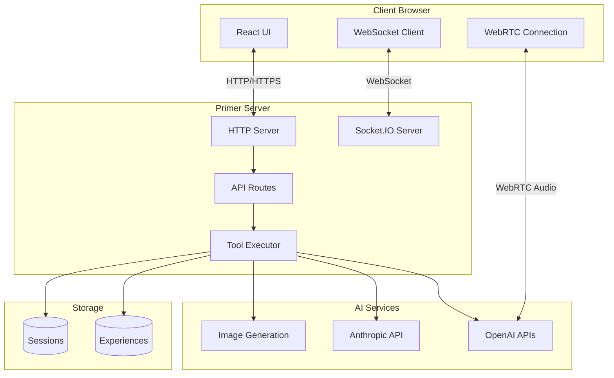
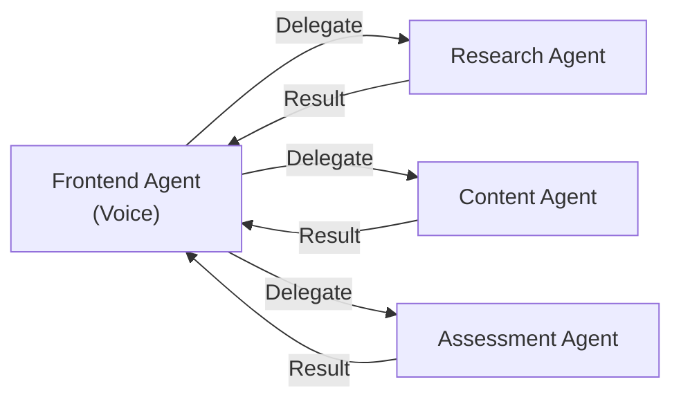
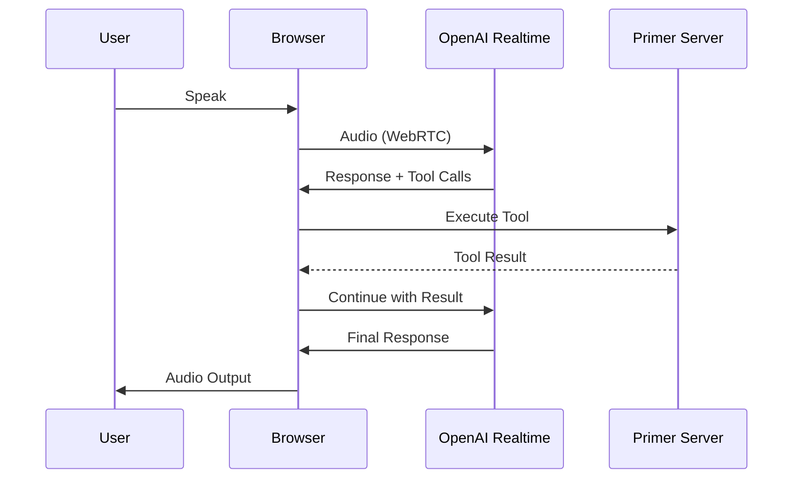
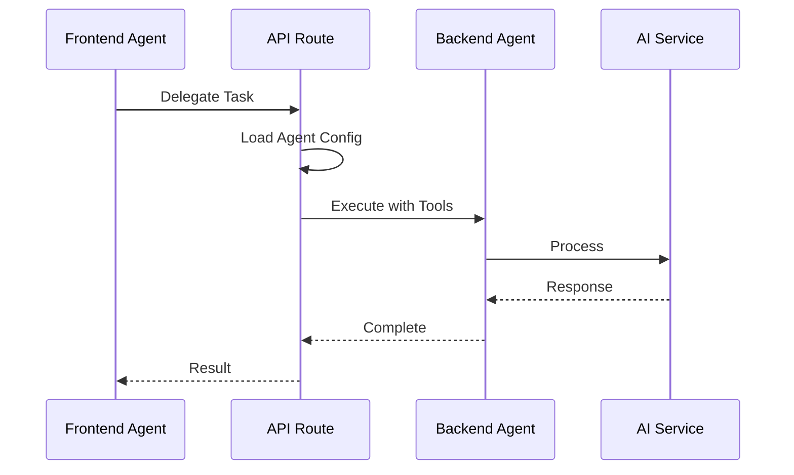
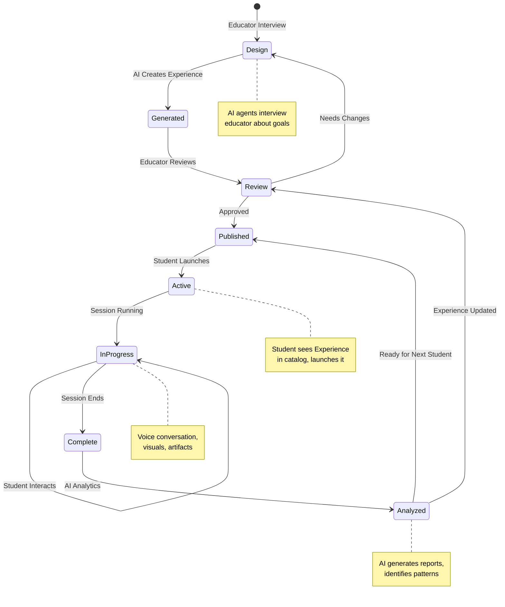

# Architecture Guide: Principles & Design

Primer is built as an AI-first platform where artificial intelligence participates at every level—from experience creation through student interaction to assessment.

**This document covers**: Technology stack, architectural principles, core concepts, design decisions, and the philosophy behind Primer's architecture.

**For visual diagrams**: See [Complete System Overview](./system-overview.md) for detailed visual breakdowns of each system layer.

## System Architecture



## Technology Stack

| Layer | Technology |
|-------|-----------|
| **Framework** | Next.js 15 (App Router) |
| **Language** | TypeScript |
| **Server** | Custom Node.js + Socket.IO |
| **UI** | React 19, Tailwind CSS, Radix UI |
| **AI** | OpenAI (Realtime + Responses), Anthropic Claude |
| **Real-time** | Socket.IO, WebRTC |
| **Auth** | NextAuth.js |

## Core Architectural Concepts

### AI Spaces

Primer creates "spaces" within the software where AI agents operate with autonomy:

- **Meta-Experience Space**: AI agents interview educators and create new experiences
- **Runtime Space**: AI agents guide students through voice conversation
- **Analytics Space**: AI agents assess sessions and generate insights

The platform provides tools and infrastructure; AI determines how to use them.

### Loose Coupling

Unlike traditional software with rigid interfaces, Primer uses loose coupling:

- Communication channels handle arbitrary payloads
- Session data is stored in free-form structures
- Tools are generic capabilities, not experience-specific functions

This enables AI to work creatively within the system.

### Agent Orchestration

Multiple specialized agents coordinate through delegation:



Frontend agents handle real-time voice interaction; backend agents handle complex processing tasks.

## Core Components

### 1. Custom Server (`server.ts`)

Integrates Next.js with Socket.IO for real-time communication:

```typescript
const server = createServer(app);
const io = new Server(server);

// Handle WebSocket connections
io.on('connection', (socket) => {
  // Real-time updates
  // Toast notifications
  // Delegation status
});
```

### 2. Experience Player (`/play/[id]`)

The main UI for running experiences:
- WebRTC connection to OpenAI Realtime API
- Real-time voice interaction
- Dynamic UI rendering (scenes, notes, slides)
- Tool execution context

### 3. Backend Agent System (`/api/backend-agent`)

Executes backend agents:
- Loads experience and agent configuration
- Registers appropriate tools based on `toolGroups`
- Supports multiple AI providers
- Handles tool call loops until completion

### 4. Tool Registry (`ToolRegistry.ts`)

Centralized tool management:
- Single source of truth for all tools
- Group-based organization
- Context-aware execution
- Frontend and backend support

### 5. ConfigLoader (`ConfigLoader.ts`)

Loads and validates experience configurations:
- Parses `experience.json`
- Validates resource paths
- Registers tools based on configuration
- Loads agent instructions from files

## Data Flow

### Voice Interaction (Real-time)



### Backend Delegation



## Runtime Environments

Primer code runs in three distinct environments:

| Environment | Location | Capabilities | Limitations |
|-------------|----------|--------------|-------------|
| **Node.js** | API routes, server.ts | Full Node.js APIs | N/A |
| **Edge** | middleware.ts | Fast, distributed | No Node.js APIs |
| **Browser** | Client components | DOM, WebRTC | No server APIs |

## Storage Architecture

Each experience is self-contained:

```
storage/
├── {experienceId}/
│   ├── experience.json          # Configuration
│   ├── resources/
│   │   ├── scenes/              # Background images
│   │   ├── sounds/              # Audio files
│   │   └── instructions/        # Agent prompts
│   └── session_data/
│       └── sess_{uuid}/         # Session artifacts
└── user-uploads/                # Uploaded files
```

This structure enables:
- **Portability**: Zip and share complete experiences
- **Isolation**: Clear boundaries between experiences
- **Flexibility**: AI creates whatever structure it needs

## Security Layers

1. **Content Security Policy**: Strict CSP headers
2. **Authentication**: NextAuth.js with file-based users
3. **Authorization**: Permission-based access control
4. **SSRF Protection**: URL validation for proxy requests
5. **HTML Sanitization**: XSS prevention
6. **Rate Limiting**: API throttling
7. **Audit Logging**: Security event tracking

## Experience Lifecycle

Experiences move through distinct states from creation to active use:



**Key States**:
- **Design**: Educator works with AI agents to define learning objectives
- **Generated**: AI creates the complete experience configuration
- **Review**: Educator validates and refines the experience
- **Published**: Experience is available in the catalog
- **Active/InProgress**: Student is engaged in a learning session
- **Complete**: Session ends and data is collected
- **Analyzed**: AI processes session data to generate insights

This lifecycle enables continuous improvement through the feedback loop from analytics back to design.

## Key Design Decisions

### Centralized Tools

All tools in one location (`src/app/lib/tools/`) rather than separate plugins:
- Easier to maintain
- Better type safety
- Simpler imports
- Clearer dependencies

### Command/Action Pattern

Tools use an `action` parameter for related functionality:
- Fewer total tools for AI to navigate
- Clearer semantics
- Easier to document
- Consistent interface

### Direct File Access

Backend agents use direct file system access:
- No authentication complexity
- Better performance
- Simpler code
- More reliable

### Experience-Centric Storage

Each experience is self-contained:
- Easy to share
- Clear boundaries
- Simple backups
- Portable

## Next Steps

- [Design Philosophy](/developer/architecture/philosophy) — Why we made these choices
- [Architecture Diagrams](/developer/architecture/diagrams) — Visual representations
- [Experience Format](/developer/architecture/experience-format) — Configuration details
- [Tools System](/developer/architecture/tools-system) — How tools work
- [Delegation](/developer/architecture/delegation) — Agent coordination
