# Core Components

Primer is built from 12 fundamental architectural components that work together to deliver AI-powered interactive experiences. This document provides an overview of each component and how they interact.

## Component Overview

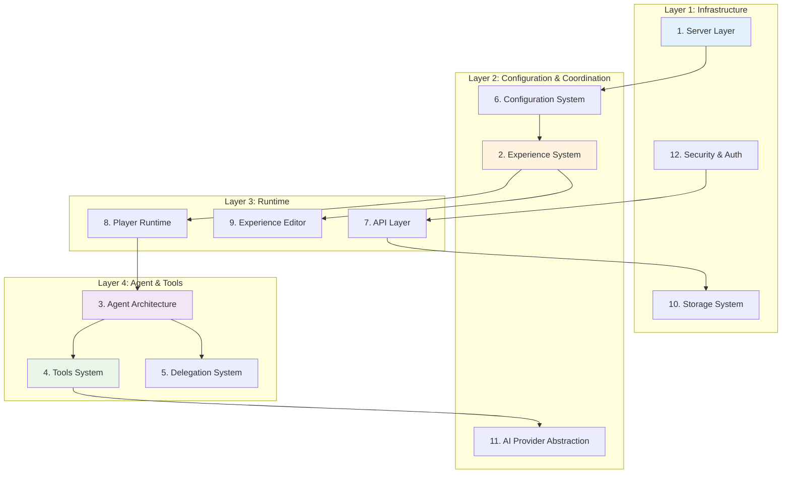

---

## 1. Server Layer

**Location**: `server.ts`

### Purpose
Custom Node.js server that integrates Next.js with Socket.IO for real-time bidirectional communication.

### Key Responsibilities
- HTTP request handling (via Next.js)
- WebSocket connection management
- Real-time message routing
- Session management (in-memory)
- Tool execution coordination via sockets
- Toast notification broadcasting

### Architecture
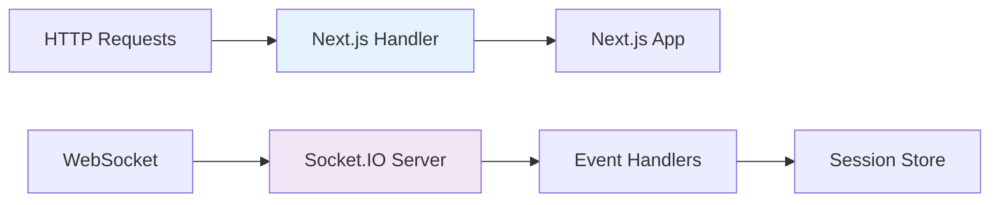

### Socket Events
- `client:message` - Incoming messages from client
- `server:message` - Outgoing messages to client
- `tool.call` - Tool execution requests
- `tool.response` - Tool execution results
- `agent.delegate` - Backend agent delegation
- `ui.observe.request/response` - UI element observation
- `component.event` - Component interaction events

**Read more**: [System Overview](./system-overview.md) - See complete system architecture

---

## 2. Experience System

**Location**: `storage/{experienceId}/`

### Purpose
Self-contained interactive scenarios that package AI agents, resources, and configurations into portable units.

### Structure
```
experience-id/
├── experience.json          # Main configuration
├── classes.json            # Class management (optional)
├── resources/
│   ├── scenes/             # Background images
│   ├── sounds/             # Audio files
│   ├── artifacts/          # Pre-defined artifacts
│   ├── components/         # Custom React components
│   └── instructions/
│       ├── agent/          # Per-agent prompts
│       └── supplemental/   # Shared instructions
├── session_data/           # Runtime session data
│   └── sess_{uuid}/
│       ├── session.json
│       ├── transcript.json
│       ├── artifacts/
│       └── events.json
└── class_data/             # Class analytics (optional)
    └── {classId}/
        └── sessions_index.json
```

### Key Features
- **Self-contained**: Everything needed for the experience in one directory
- **Portable**: Can be exported/imported as a single unit
- **Versioned**: Version tracking in experience.json
- **Multi-provider**: Supports OpenAI, Anthropic, Google AI

**Read more**: [Experience Format](./experience-format.md)

---

## 3. Agent Architecture

**Location**: `src/app/lib/ai/`

### Purpose
Dual-agent architecture separating real-time voice interaction from complex processing tasks.

### Agent Types

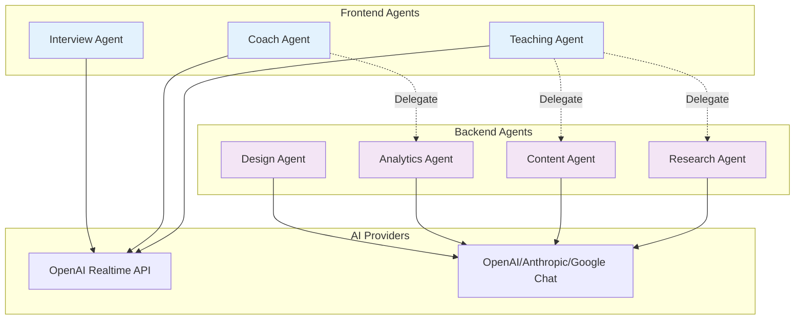

#### Frontend Agents
- Real-time voice interaction via WebRTC
- Direct user engagement
- UI tool access (notes, slides, scenes)
- Can delegate to backend agents
- Single active frontend agent per session

#### Backend Agents
- Complex processing tasks
- Direct file system access (no HTTP/auth overhead)
- Can modify experiences
- Generate analytics and reports
- Multiple backend agents can run concurrently

### Context Differences

**Frontend Context** (UI-focused):
```typescript
{
  experienceId: string;
  sessionId: string;
  availableScenes: Record<string, ResourceInfo>;
  availableSounds: Record<string, ResourceInfo>;
  setScene: (name: string) => void;
  playSound: (name: string) => void;
  // ... UI manipulation functions
}
```

**Backend Context** (File-focused):
```typescript
{
  experienceId: string;
  sessionId: string;
  delegationId?: string;
  userInfo?: { name: string; email: string };
  readFile: (path: string) => Promise<string>;
  writeFile: (path: string, content: string) => Promise<void>;
  listArtifacts: () => Promise<Artifact[]>;
  createArtifact: (name, content, type) => Promise<string>;
  // ... direct file operations
}
```

**Read more**: [Agent Architecture](./agent-architecture.md)

---

## 4. Tools System

**Location**: `src/app/lib/tools/`, `plugins/`

### Purpose
Extensible framework providing capabilities to AI agents through a unified interface.

### Tool Organization

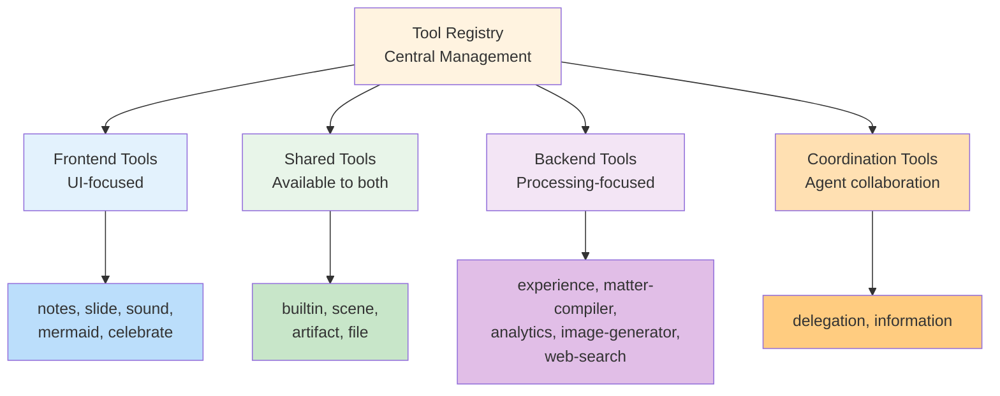

### Tool Groups
Tools are organized into groups that agents can be assigned:
- **builtin**: Core functionality
- **notes**: Sticky note UI
- **slide**: Presentation slides
- **sound**: Audio playback
- **mermaid**: Diagram rendering
- **celebrate**: Celebration animations
- **delegation**: Backend agent delegation
- **experience**: File/directory operations
- **matter-compiler**: Experience config modification
- **image-generator**: AI image generation
- **analytics**: Session analytics
- **web-search**: Research capability

### Command/Action Pattern
Tools use an `action` parameter to group related functionality:
```typescript
// Instead of: scene_show, scene_hide, scene_list
// We have: scene with actions: show, hide, list
{
  name: "scene",
  actions: ["show", "hide", "list"],
  // ...
}
```

**Read more**: [Tools System](./tools-system.md)

---

## 5. Delegation System

**Location**: `src/app/lib/tools/delegation/`, `/api/backend-agent`

### Purpose
Enables frontend agents to hand off complex tasks to specialized backend agents.

### Delegation Flow

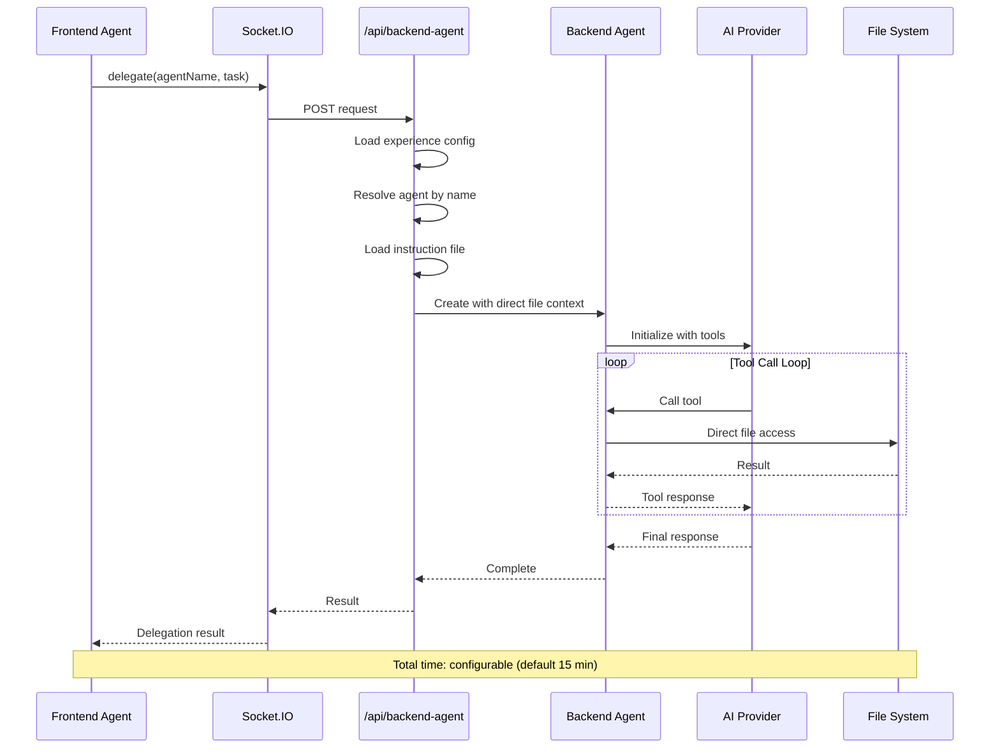

### Key Features
- **Direct File Access**: Backend agents bypass HTTP/authentication
- **Configurable Timeout**: Default 15 minutes, can be customized
- **Real-time Status**: Socket updates keep frontend informed
- **Error Handling**: Graceful failure with detailed error messages
- **Tool Isolation**: Backend agents only get their assigned tool groups

**Read more**: [Delegation](./delegation.md)

---

## 6. Configuration System

**Location**: `src/app/lib/ConfigLoader/`

### Purpose
Loads, validates, and processes experience configurations with specialized managers.

### Architecture

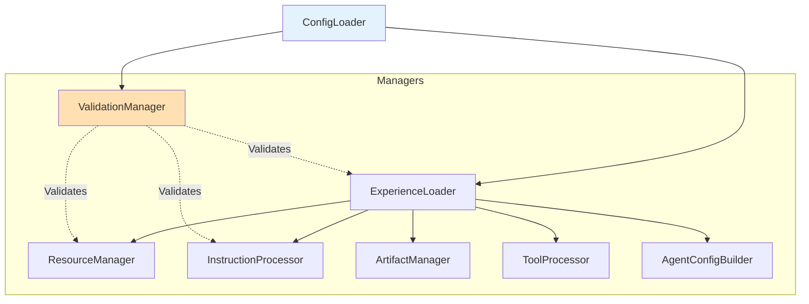

### Loading Sequence
1. **Reset State** - Clear previous configuration
2. **Load Experience** - Parse experience.json
3. **Load Instructions** - Process agent instruction files (parallel)
4. **Load Artifacts** - Validate pre-defined artifacts (parallel)
5. **Process Tools** - Register tools based on toolGroups
6. **Build Agents** - Create agent configurations
7. **Validate** - Check all resources and return errors/warnings
8. **Return ConfigResponse** - Complete configuration object

### Validation Levels
- **Errors**: Block experience from running
- **Warnings**: Allow running but notify of issues
- **Info**: Informational messages

**Read more**: See experience loading details in [Data Flows](./data-flows.md)

---

## 7. API Layer

**Location**: `src/app/api/`

### Purpose
RESTful endpoints for all server operations with authentication and authorization.

### API Categories

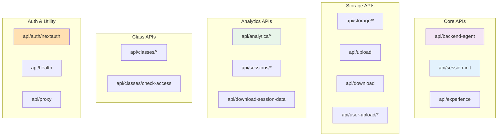

### 28+ API Routes
- **Core**: Backend agent execution, session management, experience CRUD
- **Storage**: File operations, uploads, downloads
- **Analytics**: Session data, reports, exports
- **Classes**: Class management, access control
- **Auth**: NextAuth.js authentication
- **Utilities**: Health checks, proxy (SSRF-protected), diagnostics

### Security
- NextAuth.js authentication on protected routes
- CORS protection with allowlist
- Rate limiting
- Input validation with Zod
- SSRF protection on proxy endpoint

**Read more**: See API routes in [Architecture Guide](./architecture-guide.md)

---

## 8. Player Runtime

**Location**: `src/app/play/[id]/page.tsx`

### Purpose
Main user interface for playing experiences with voice interaction and visual elements.

### Architecture

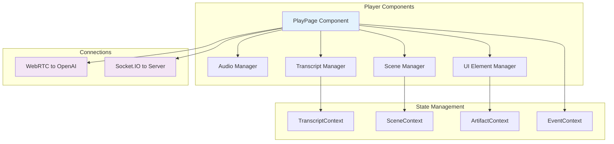

### Loading Phases
1. Access check
2. Session recovery check
3. AI configurations
4. Agents
5. Sounds
6. Scenes
7. Tools
8. Plugins
9. Audio initialization
10. Scene initialization
11. Complete

### Features
- Session management (creation, recovery)
- Real-time voice interaction
- Scene/background management
- Sound playback
- UI elements (notes, slides, artifacts)
- Tool execution coordination
- Access control

**Read more**: See player details in [Data Flows](./data-flows.md)

---

## 9. Experience Editor

**Location**: `src/app/manage/[id]/`

### Purpose
Interface for creating and configuring experiences.

### Capabilities
- **Metadata Editing**: Title, description, version
- **Agent Configuration**: Add/edit/remove agents
- **Resource Management**: Upload scenes, sounds, instructions
- **Tool Assignment**: Assign tool groups to agents
- **AI Configuration**: Set up provider settings
- **Import/Export**: Share experiences
- **Template System**: Start from templates

### Editor Flow
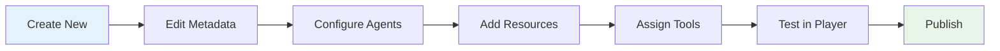

---

## 10. Storage System

**Location**: `src/app/lib/storage/`

### Purpose
Abstracted file system operations for experiences and sessions.

### Architecture

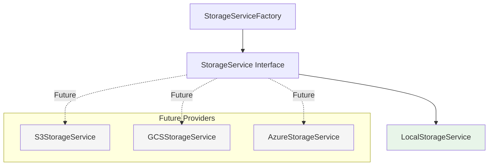

### Operations
- **Read**: Read file contents
- **Write**: Write file contents
- **Delete**: Remove files
- **List**: List directory contents
- **Move**: Move files/directories
- **Copy**: Copy files/directories
- **Exists**: Check if path exists

### Storage Paths
- **Experiences**: `storage/{experienceId}/`
- **Sessions**: `storage/{experienceId}/session_data/sess_{uuid}/`
- **User Uploads**: `storage/user-uploads/`

---

## 11. AI Provider Abstraction

**Location**: `src/app/lib/ai/`

### Purpose
Multi-provider support for different AI services with a unified interface.

### Provider Hierarchy

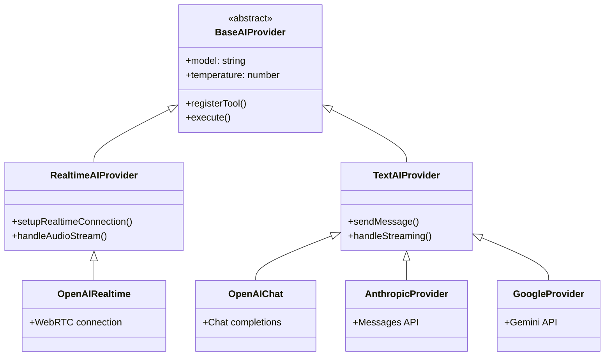

### Supported Providers
- **OpenAI Realtime API** - Voice interaction (frontend agents)
- **OpenAI Chat API** - Text processing (backend agents)
- **Anthropic Claude** - Alternative text processing
- **Google Gemini** - Alternative text processing

### Configuration
Each experience can define multiple AI configurations:
```json
{
  "aiConfigurations": {
    "default": {
      "provider": "openai-realtime",
      "model": "gpt-4o-realtime-preview",
      "temperature": 0.8
    },
    "backend-claude": {
      "provider": "anthropic",
      "model": "claude-3-5-sonnet-20241022",
      "temperature": 0.7
    }
  }
}
```

---

## 12. Security & Authentication

**Location**: `src/lib/csp.ts`, `src/middleware.ts`, `src/app/api/auth/`

### Purpose
Comprehensive security framework protecting users and data.

### Security Layers

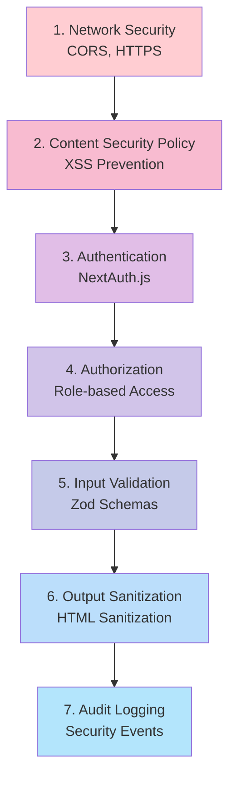

### Components
- **Content Security Policy**: XSS and injection protection
- **NextAuth.js**: Google OAuth integration
- **Permission System**: Role-based access control (admin/teacher/student)
- **SSRF Protection**: URL validation for proxy requests
- **HTML Sanitization**: Safe dynamic content rendering
- **Audit Logging**: Security event tracking
- **Rate Limiting**: API request throttling

### Authentication Flow
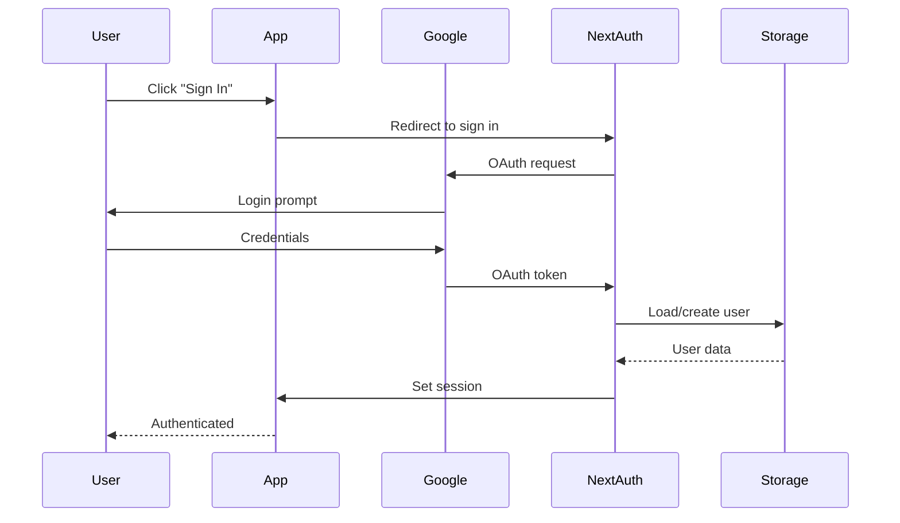

**Read more**: [Security Architecture](./security-csp.md)

---

## Component Interactions

### How Components Work Together

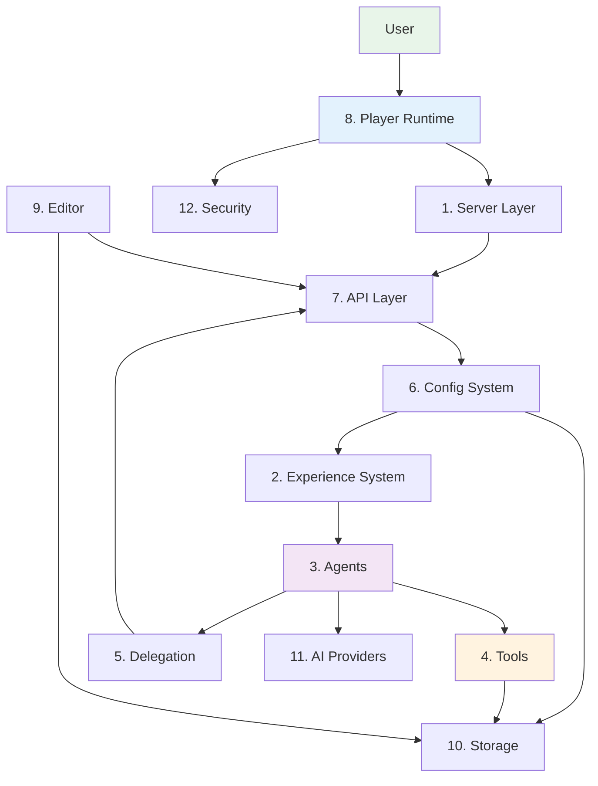

---

## Next Steps

Now that you understand the core components, explore:

- [System Overview](./system-overview.md) - Complete system architecture with diagrams
- [Agent Architecture](./agent-architecture.md) - Frontend and backend agents
- [Data Flows](./data-flows.md) - How data moves through the system
- [Tools System](./tools-system.md) - How tools work
- [Delegation](./delegation.md) - Agent coordination
