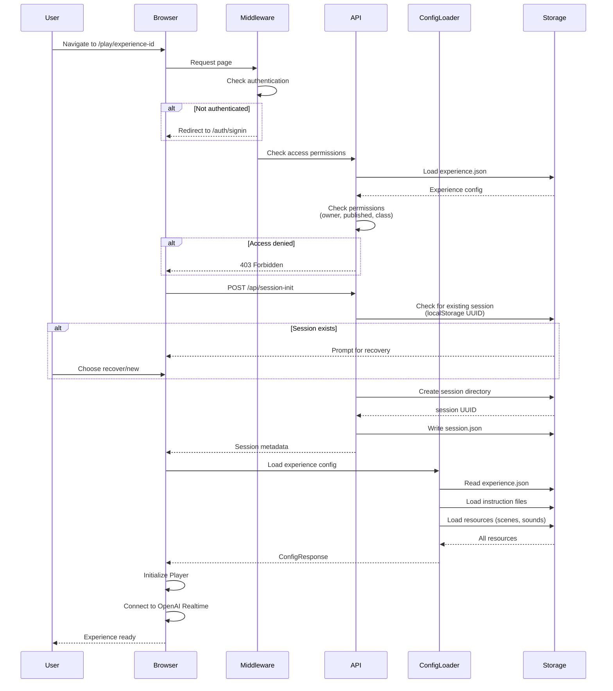
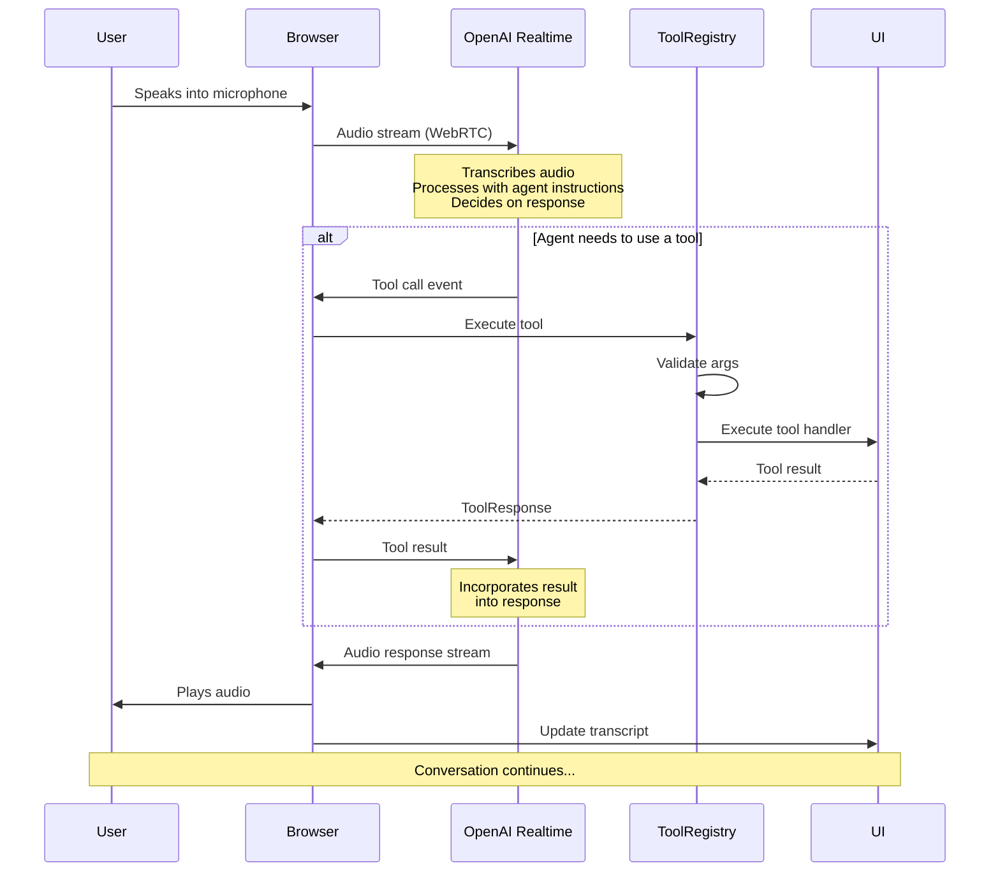
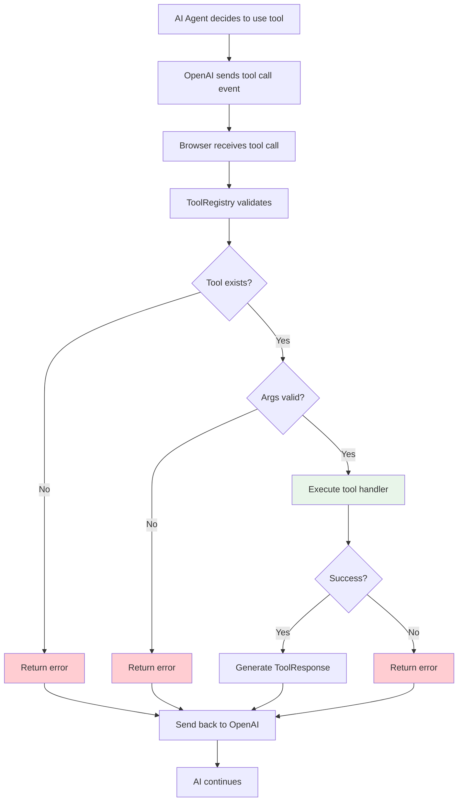
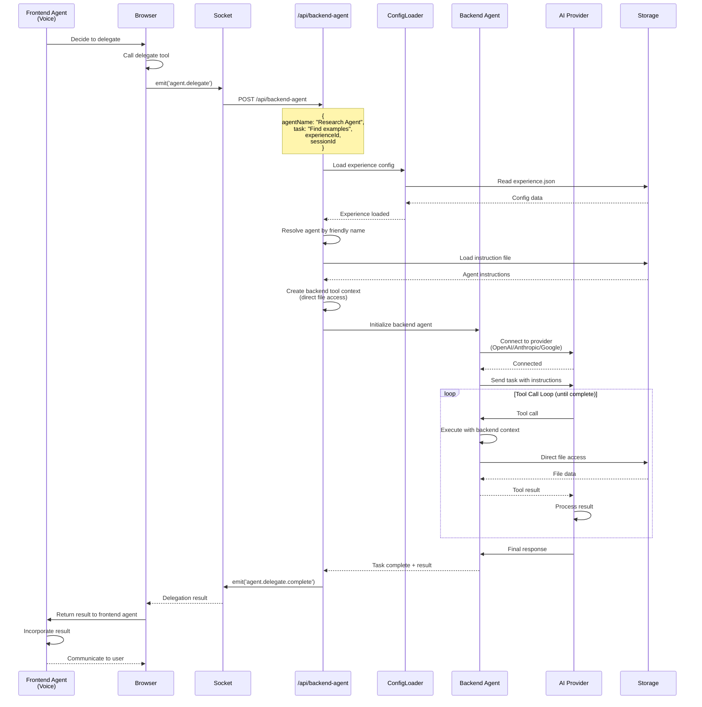
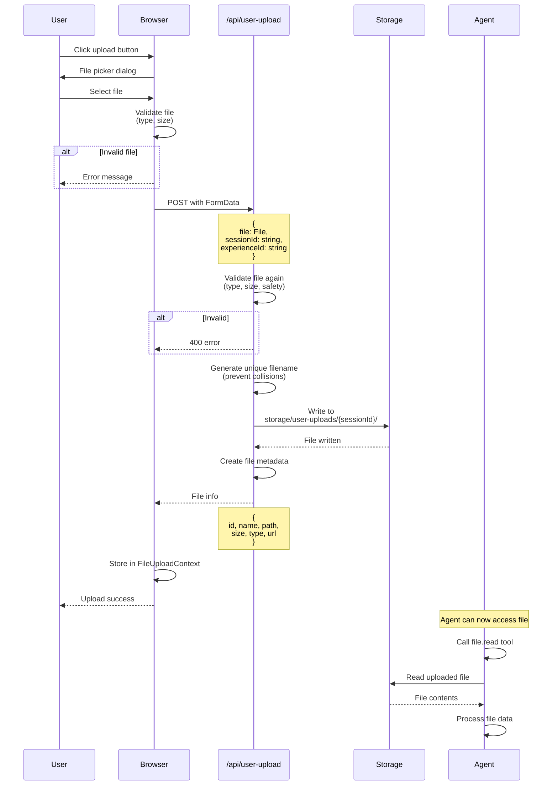
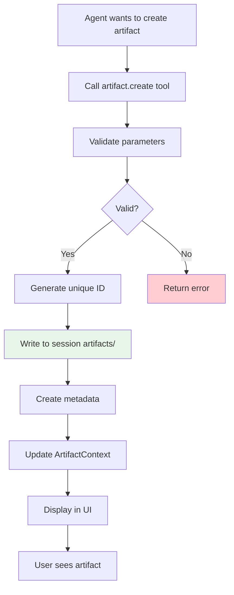
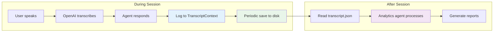
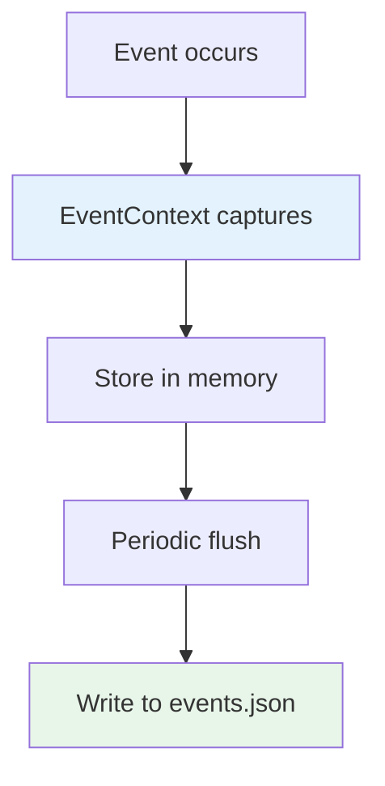

# Data Flow Patterns

Understanding how data moves through Primer is essential for developing experiences and debugging issues. This document maps out the key data flows with detailed diagrams.

## Overview

Primer has four primary data flow patterns:
1. **Session Initialization** - Starting a new experience
2. **Voice Interaction** - Real-time conversation
3. **Tool Execution** - Agent capabilities
4. **Backend Delegation** - Complex task handoff
5. **File Upload** - User file handling

---

## 1. Session Initialization Flow

When a user launches an experience, several steps occur to prepare the runtime environment.



### Loading Phases

The Player component displays progress through 11 phases:

| Phase | Description | What Happens |
|-------|-------------|--------------|
| 1 | Access Check | Verify user permissions |
| 2 | Session Recovery | Check for existing session |
| 3 | AI Configurations | Load provider settings |
| 4 | Agents | Load agent configurations |
| 5 | Sounds | Validate audio files |
| 6 | Scenes | Validate background images |
| 7 | Tools | Register tool groups |
| 8 | Plugins | Initialize plugins (legacy) |
| 9 | Audio Init | Set up microphone/speakers |
| 10 | Scene Init | Load initial background |
| 11 | Complete | Ready for interaction |

---

## 2. Voice Interaction Flow

Real-time conversation between user and frontend agent via OpenAI Realtime API.



### Voice Flow Details

1. **Audio Capture**: Browser captures microphone input
2. **WebRTC Streaming**: Audio sent to OpenAI in real-time
3. **Transcription**: OpenAI transcribes speech to text
4. **Agent Processing**: AI processes with agent instructions and context
5. **Tool Decisions**: If tools needed, sends tool call events
6. **Tool Execution**: Browser executes tools via ToolRegistry
7. **Response Generation**: OpenAI generates response incorporating tool results
8. **Audio Streaming**: Response streamed back as audio
9. **Playback**: Browser plays audio response to user
10. **Transcript Update**: Conversation logged to transcript

---

## 3. Tool Execution Flow

How tools are called and executed in both frontend and backend contexts.

### Frontend Tool Execution



### Tool Execution Example

```typescript
// AI decides to show a scene
{
  "tool": "scene",
  "args": {
    "action": "show",
    "name": "forest-morning"
  }
}

// ToolRegistry executes
const result = await ToolRegistry.execute(
  "scene",
  { action: "show", name: "forest-morning" },
  frontendContext
);

// Tool handler runs
sceneContext.setScene("forest-morning");

// Returns success
{
  "success": true,
  "result": "Scene changed to forest-morning"
}
```

---

## 4. Backend Delegation Flow

Frontend agents delegate complex tasks to specialized backend agents.



### Delegation Configuration

```json
{
  "agents": {
    "tutor": {
      "type": "frontend",
      "downstreamAgents": ["research", "content", "quiz"]
    },
    "research": {
      "type": "backend",
      "toolGroups": ["builtin", "web-search"],
      "aiConfiguration": "backend-claude"
    }
  }
}
```

### Delegation Timeout

Default: **15 minutes** (configurable via `DELEGATE_AGENT_TIMEOUT_MS`)

If backend agent exceeds timeout:
- Execution terminated
- Error returned to frontend agent
- Frontend agent can inform user and try alternative approach

---

## 5. File Upload Flow

How users upload files that agents can access.



### File Upload Details

**Supported File Types** (configurable):
- Documents: PDF, DOCX, TXT, MD
- Images: PNG, JPG, JPEG, GIF, WEBP
- Data: CSV, JSON, XLSX
- Code: JS, TS, PY, etc.

**Size Limits**:
- Default: 10MB per file
- Configurable via environment

**Security**:
- Type validation
- Size validation
- Sanitized filenames
- Isolated per session
- Automatic cleanup (session end)

---

## 6. Artifact Creation Flow

Agents create artifacts (documents, reports, diagrams) during sessions.



### Artifact Types

| Type | Description | Rendering |
|------|-------------|-----------|
| `markdown` | Markdown document | Rendered as formatted text |
| `html` | HTML document | Sanitized and rendered |
| `code` | Source code | Syntax highlighted |
| `json` | JSON data | Formatted and collapsible |
| `csv` | Tabular data | Rendered as table |
| `image` | Image URL | Displayed as image |
| `mermaid` | Mermaid diagram | Rendered as diagram |

### Artifact Storage

```
storage/
└── experience-id/
    └── session_data/
        └── sess_uuid/
            └── artifacts/
                ├── artifact-1.md
                ├── artifact-2.html
                ├── artifact-3.json
                └── metadata.json
```

---

## 7. Session Transcript Flow

How conversations are logged and can be accessed.



### Transcript Format

```json
{
  "sessionId": "sess_uuid",
  "experienceId": "experience-id",
  "startTime": "2024-01-01T10:00:00Z",
  "messages": [
    {
      "timestamp": "2024-01-01T10:00:05Z",
      "role": "user",
      "content": "Hello, can you help me learn about physics?",
      "transcribed": true
    },
    {
      "timestamp": "2024-01-01T10:00:08Z",
      "role": "assistant",
      "agentName": "Physics Tutor",
      "content": "Of course! I'd be happy to help you learn about physics.",
      "toolCalls": []
    },
    {
      "timestamp": "2024-01-01T10:00:12Z",
      "role": "tool",
      "toolName": "scene",
      "args": { "action": "show", "name": "physics-lab" },
      "result": { "success": true }
    }
  ]
}
```

---

## 8. Event Logging Flow

System events and tool uses are logged for debugging and analytics.



### Event Types

- **Session Events**: Start, end, pause, resume
- **Tool Events**: Tool calls and results
- **Agent Events**: Agent switches, delegations
- **UI Events**: Scene changes, slide shows, note displays
- **Error Events**: Errors and warnings
- **User Events**: User interactions with components

### Events File

```json
{
  "sessionId": "sess_uuid",
  "events": [
    {
      "timestamp": "2024-01-01T10:00:00Z",
      "type": "session.start",
      "data": { "experienceId": "exp-123" }
    },
    {
      "timestamp": "2024-01-01T10:00:05Z",
      "type": "tool.call",
      "data": {
        "tool": "scene",
        "action": "show",
        "args": { "name": "forest" }
      }
    },
    {
      "timestamp": "2024-01-01T10:00:06Z",
      "type": "ui.scene.change",
      "data": { "from": null, "to": "forest" }
    }
  ]
}
```

---

## 9. Analytics Flow

After a session completes, raw session data is processed by AI agents to generate meaningful insights for educators and students.

```mermaid
flowchart LR
    subgraph RAW["Raw Session Data"]
        TR["📝 Transcript<br/>Everything said"]
        AT["📄 Artifacts<br/>Created documents"]
        EV["📊 Events<br/>Tool uses, scenes"]
        TI["⏱️ Timing<br/>Pauses, duration"]
    end

    subgraph PROCESS["AI Processing"]
        IND["Individual<br/>Analysis Agent"]
        COH["Cohort<br/>Analysis Agent"]
    end

    subgraph INSIGHTS["Generated Insights"]
        PERF["Performance<br/>Assessment"]
        GAPS["Knowledge<br/>Gaps"]
        PATT["Behavioral<br/>Patterns"]
        REC["Recommendations"]
    end

    subgraph OUTPUT["Outputs"]
        STU_REP["Student<br/>Report"]
        EDU_REP["Educator<br/>Dashboard"]
        SYS_REP["System<br/>Improvements"]
    end

    RAW --> PROCESS
    PROCESS --> INSIGHTS
    INSIGHTS --> OUTPUT

    style RAW fill:#e3f2fd
    style PROCESS fill:#f3e5f5
    style INSIGHTS fill:#fff3e0
    style OUTPUT fill:#e8f5e9
```



### Analytics Pipeline

1. **Data Collection**
   - Transcript: Complete conversation history
   - Artifacts: All generated documents and materials
   - Events: Tool calls, UI changes, timing data
   - Metadata: Session duration, engagement metrics

2. **Individual Analysis**
   - AI agent processes single-student session data
   - Assesses understanding and performance
   - Identifies knowledge gaps and misconceptions
   - Generates personalized feedback

3. **Cohort Analysis**
   - Aggregates data across multiple students
   - Identifies common patterns and trends
   - Highlights areas where students struggle
   - Suggests experience improvements

4. **Output Generation**
   - Student reports with personalized feedback
   - Educator dashboards with cohort insights
   - System recommendations for experience refinement

**Note**: Analytics processing typically happens asynchronously after session completion to avoid impacting the student experience.

---

## Performance Considerations

### Optimization Strategies

1. **Parallel Loading**: Load resources in parallel during initialization
2. **Lazy Loading**: Load components only when needed
3. **Caching**: Cache experience configs in memory
4. **Streaming**: Stream AI responses for perceived speed
5. **WebRTC**: Direct audio streaming to OpenAI (bypass server)
6. **Socket.IO**: Real-time updates without polling

### Bottlenecks to Avoid

- ❌ Loading all artifacts at once
- ❌ Synchronous file operations
- ❌ Unvalidated user input
- ❌ Large transcript files without pagination
- ❌ Unoptimized images/audio

### Best Practices

- ✅ Validate early and often
- ✅ Use direct file access for backend agents
- ✅ Keep tool responses concise
- ✅ Compress large files
- ✅ Clean up temporary files
- ✅ Monitor delegation timeouts

---

## Debugging Data Flows

### Common Issues

| Issue | Symptom | Check |
|-------|---------|-------|
| Session not loading | Stuck on loading phase | Check ConfigLoader validation errors |
| Tool not working | Tool call fails | Check ToolRegistry registration |
| Delegation timeout | Backend agent doesn't respond | Check agent instruction file, tool availability |
| File upload fails | 400/500 error | Check file type, size, permissions |
| Audio not working | No voice input/output | Check WebRTC connection, browser permissions |

### Diagnostic Tools

- **Browser DevTools**: Network tab, console logs
- **API Endpoints**: `/api/diagnostic/*` routes
- **Logs**: Server logs (Pino structured logging)
- **Events**: Check events.json for detailed timeline
- **Transcript**: Review transcript.json for conversation flow

---

## Next Steps

- [Agent Architecture](./agent-architecture.md) - How agents work
- [Tools System](./tools-system.md) - Tool implementation details
- [Delegation](./delegation.md) - Deep dive on delegation
- [Security](./security-csp.md) - Security considerations in data flows
