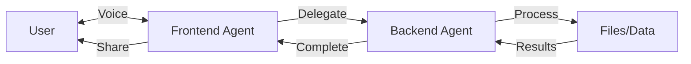
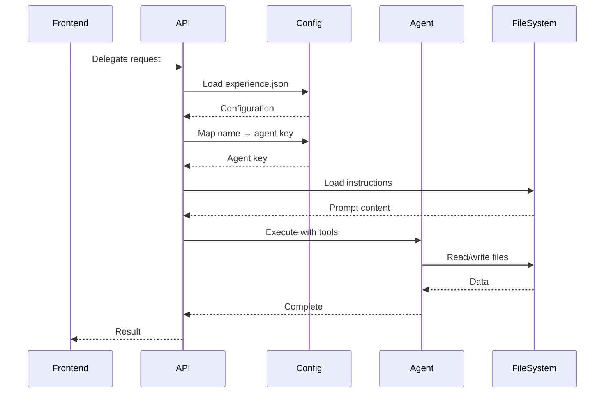
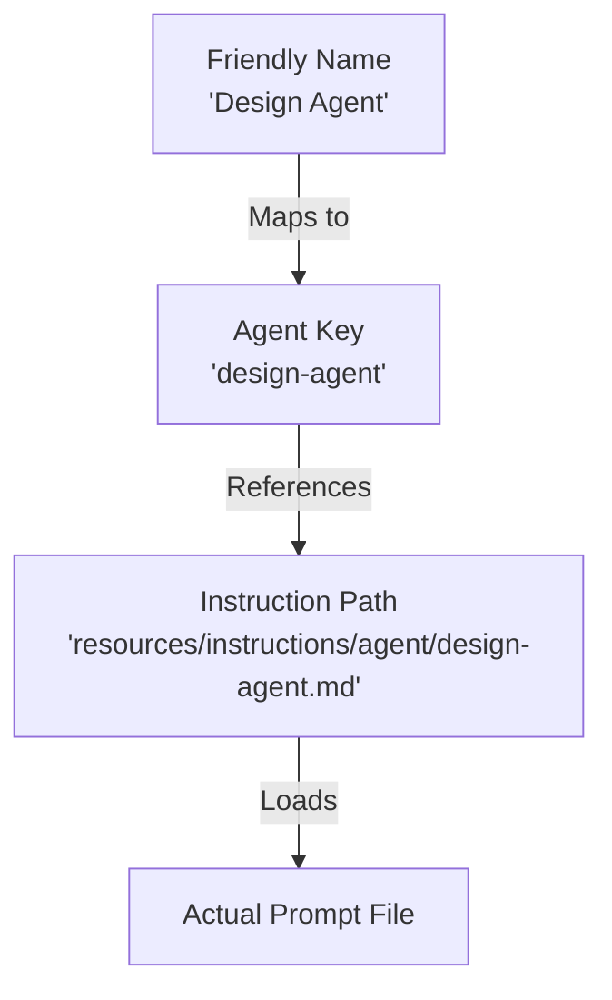
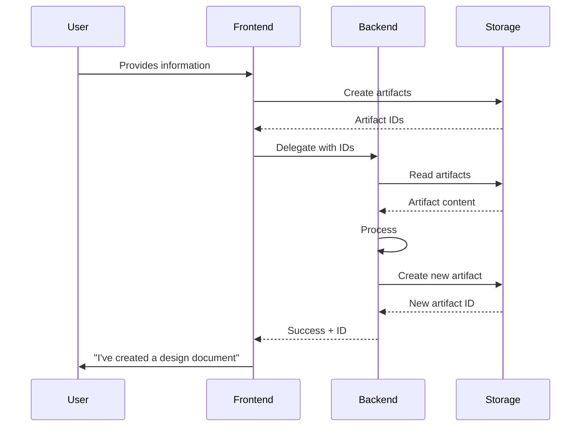

# Delegation System

Frontend agents can delegate complex tasks to specialized backend agents.

## Overview



**Key Concept**: Frontend agents handle user interaction, backend agents handle complex processing.

## How It Works

### 1. Frontend Initiates

Frontend agent calls `delegate` tool:

```typescript
delegate({
  agentType: "Design Agent",  // Friendly name
  artifactIds: ["uuid-1", "uuid-2"],
  taskDescription: "Create design document from intake notes"
})
```

### 2. Backend Processes

`/api/backend-agent` route:



1. Load `experience.json`
2. Map friendly name → agent key → instruction file
3. Load instruction file from disk
4. Create server-side tool context
5. Execute agent with tools
6. Return results

### 3. Results Return

Backend agent completes and returns:
- Success/failure status
- Created artifact IDs
- Summary message

## Agent Name Mapping



**Why**: Friendly names for delegation calls, internal keys for file mapping.

## Tool Context

Backend agents get direct file system access:

```typescript
{
  // Artifact operations (no HTTP)
  listArtifacts: () => /* Direct JSON reads */,
  getArtifact: (id) => /* Direct file read */,
  createArtifact: (name, content, type) => /* Direct write */,
  
  // Experience operations
  createFile: (expId, path, content) => /* Direct write */,
  listResources: (expId) => /* Direct traversal */,
  // ...
}
```

**Benefit**: No authentication issues, better performance, simpler code.

## Configuration

### Experience Setup

```json
{
  "agents": {
    "intake": {
      "name": "Intake Agent",
      "type": "frontend",
      "toolGroups": ["builtin", "notes", "delegation"],
      "downstreamAgents": ["design-agent"]
    },
    "design-agent": {
      "name": "Design Agent",
      "type": "backend",
      "temperature": 0.8,
      "aiConfiguration": "claude-agent",
      "toolGroups": ["builtin", "experience", "matter-compiler"]
    }
  },
  "resources": {
    "instructions": {
      "agent": {
        "intake": "resources/instructions/agent/intake.md",
        "design-agent": "resources/instructions/agent/design-agent.md"
      }
    }
  }
}
```

### Agent Instructions

**Frontend agent** (`intake.md`):
```markdown
# Intake Agent

When the user completes intake, delegate to Design Agent:

Use the delegate tool with:
- agentType: "Design Agent"
- artifactIds: [intake artifacts]
- taskDescription: "Create experience design"
```

**Backend agent** (`design-agent.md`):
```markdown
# Design Agent

You receive intake artifacts and create an experience design.

1. Retrieve artifacts using `artifact` tool
2. Analyze content
3. Create design document
4. Return artifact ID
```

## Typical Workflow



## Best Practices

### For Frontend Agents

1. **Use friendly names** in delegation calls
2. **Provide context** in task description
3. **Include relevant artifact IDs**
4. **Handle errors gracefully**
5. **Inform user** about delegation

### For Backend Agents

1. **Always create artifacts** for outputs
2. **Use descriptive names** for artifacts
3. **Log operations** for debugging
4. **Handle errors** with clear messages
5. **Return meaningful results**

### For Experience Design

1. **Limit downstream agents** to necessary ones
2. **Use appropriate tool groups**
3. **Set correct temperatures**
4. **Test delegation flow**
5. **Document agent responsibilities**

## Error Handling

### Agent Not Found

```
Error: Agent "Unknown Agent" not found
Available agents: Intake Agent, Design Agent
```

### Missing Instructions

```
Error: Instruction file not found: 
  resources/instructions/agent/missing.md
```

### Tool Failures

Backend agents should handle tool failures:

```typescript
try {
  const artifact = await getArtifact(id);
  // Process...
} catch (error) {
  return {
    status: 'error',
    message: `Failed to retrieve artifact: ${error.message}`
  };
}
```

## Real-Time Updates

Delegation status updates via Socket.IO:

```typescript
socket.emit('delegation:start', { delegationId, agentName });
socket.emit('delegation:complete', { delegationId, result });
socket.emit('delegation:error', { delegationId, error });
```

Frontend can show progress indicators.

## Security Considerations

1. **Validate agent names** before loading
2. **Sanitize file paths** to prevent traversal
3. **Limit tool access** via tool groups
4. **Log delegation events** for audit
5. **Rate limit** delegation calls

## Debugging

Enable detailed logging:

```typescript
console.log('[DELEGATION] Starting:', {
  agentName,
  artifactIds,
  taskDescription
});
```

Check:
- Agent name mapping
- Instruction file loading
- Tool context creation
- Tool execution
- File operations

## Performance

### Optimization Tips

1. **Minimize artifact reads** - batch if possible
2. **Cache configurations** - don't reload repeatedly
3. **Use appropriate models** - faster models for simple tasks
4. **Limit tool calls** - be efficient in prompts
5. **Stream responses** when supported

### Monitoring

Track:
- Delegation duration
- Tool call counts
- File operation counts
- Error rates
- Model token usage

## Next Steps

- [Tools System](/developer/architecture/tools-system) - Available tools
- [AI Providers](/developer/architecture/ai-providers) - Model selection
- [Experience Format](/developer/architecture/experience-format) - Configuration
- [Custom Tools](/developer/guides/custom-tools) - Build delegation tools
