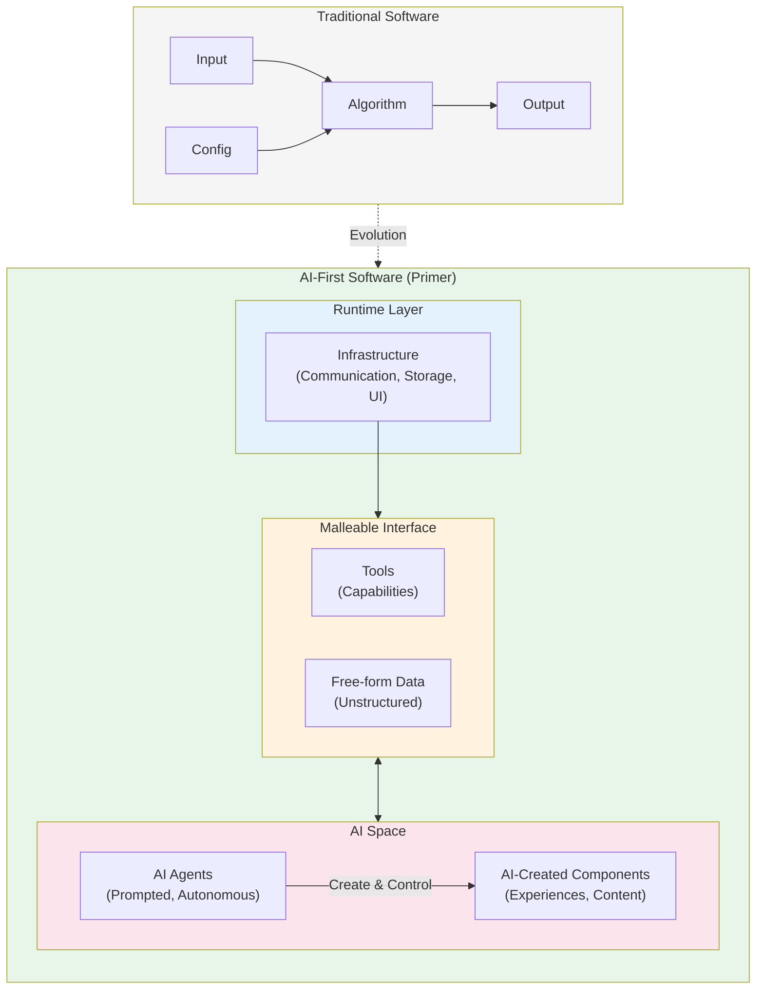
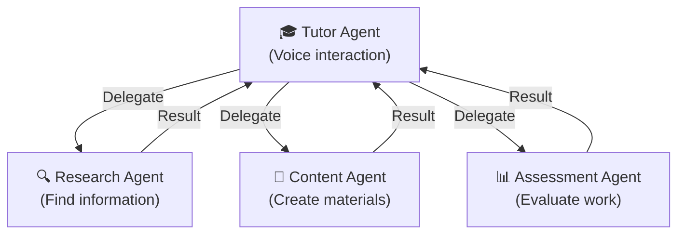

# Design Philosophy

Primer represents a new approach to software architecture—one built around AI as a first-class participant rather than an external service. This document explains the thinking behind Primer's design and the principles that guide its development.

## AI-First Architecture

### A Paradigm Shift

Traditional software follows predictable patterns: algorithms process data according to predefined logic, interfaces are concrete and typed, and system capabilities are limited to what developers explicitly programmed.

**Primer takes a fundamentally different approach.** Instead of treating AI as a feature or external API call, Primer creates "spaces" within the software where AI agents can direct, control, and extend the system itself.



### The Core Insight

> Software systems can be designed to accommodate AI not just as an external service, but as an active participant in the system's operation and evolution.

This means:
- **Creating space for AI agency** — Architectural areas where AI agents can operate with appropriate autonomy
- **Loose coupling by design** — Communication layers that allow AI to interact without rigid interface requirements
- **Emergent capabilities** — Features that arise from AI interaction, not just explicit programming
- **Runtime extensibility** — AI can create and deploy new components while the system runs

## AI at Every Layer

Primer implements AI participation across multiple layers:

### Meta-Experience Layer (AI Creates)

At the highest layer, AI agents with domain expertise interview educators and synthesize those conversations into complete, novel Experiences. The system itself has no preconception of what experiences will be created—AI handles the creative work.

### Experience Layer (AI Teaches)

Each Experience runs with AI agents that interact with students in real-time. These agents pursue learning objectives adaptively, not through scripted paths but through intelligent judgment about how to respond to each student.

### Analytics Layer (AI Assesses)

After student sessions complete, AI agents analyze the unstructured session data—transcripts, artifacts, behavioral signals—and produce meaningful assessments without requiring predefined metrics.

### Runtime Layer (AI Enabled)

The platform provides infrastructure (communication, storage, tools) that accommodates AI operation at all levels above, without constraining what AI can do.

## Core Principles

### 1. Create Space, Not Constraints

Instead of defining what AI can do, define where AI can operate. Provide tools, context, and communication channels. Let AI determine the specifics.

**Traditional approach:**
```typescript
// Defines exactly what a tutor can do
interface TutorComponent {
  introduce(): void;
  presentLesson(topic: string): void;
  assessUnderstanding(): AssessmentResult;
}
```

**AI-first approach:**
```typescript
// Provides capabilities without prescribing behavior
const tools = [
  changeScene,      // AI decides when to change visuals
  showSlide,        // AI decides what to present
  createArtifact,   // AI decides what to create
  delegate,         // AI decides when to get help
];
// Agent prompt defines goals, not procedures
```

### 2. Embrace Unknown Data Shapes

Traditional systems require data to conform to schemas. This fails for AI-first systems because:

- **We don't know what we don't know** — Future educational approaches may require data structures we can't anticipate
- **AI capabilities evolve rapidly** — Constraining data shapes constrains future capabilities
- **Creativity requires freedom** — Novel pedagogical approaches may emerge from novel data representations

Primer stores session data in free-form structures that AI interprets later, rather than forcing everything into predefined fields.

### 3. Trust AI with Interpretation

Rather than encoding business logic in code, encode it in prompts and let AI interpret. This makes the system more adaptable and easier to evolve.

**Example:** Instead of writing code that determines when a student is confused, describe confusion signals in the agent's instructions and let it detect and respond appropriately.

### 4. Layer AI Agency

Different AI agents operate at different levels of abstraction with clear boundaries:

| Layer | AI Role | Creates |
|-------|---------|---------|
| **Meta** | Interviews, designs | Experiences |
| **Runtime** | Teaches, guides | Artifacts, responses |
| **Analytics** | Assesses, reports | Insights, grades |

### 5. Preserve Context, Not Just Data

AI works best with rich context. Primer stores transcripts, artifacts, and observations—not just computed metrics. This allows AI to derive meaning later, even from data whose significance wasn't anticipated at capture time.

## Self-Contained Experiences

Each Experience is a complete, portable package:

**Why:**
- Easy to share and distribute
- Clear ownership and boundaries
- Enables rapid experimentation
- No external dependencies

**Implementation:**
```
experience/
├── experience.json          # Configuration
├── resources/
│   ├── scenes/              # Visual assets
│   ├── sounds/              # Audio assets
│   └── instructions/        # Agent prompts
└── session_data/            # Generated during use
```

An Experience can be created by AI, zipped up, shared, and run anywhere Primer is installed.

## Composable AI Agents

Complex behaviors emerge from simple, specialized agents working together:



**Why composition:**
- Easier to reason about individual agents
- Promotes reusability
- Enables specialization
- Simplifies debugging

## Voice-First Interaction

Voice is the primary interface; visual elements enhance but don't replace conversation.

**Why:**
- More natural interaction
- Reduces cognitive load
- Enables hands-free use
- Aligns with conversational AI capabilities

**Implementation:**
- OpenAI Realtime API for natural voice conversation
- Visual elements appear contextually (scenes, slides, diagrams)
- Tools controlled through conversation flow
- UI responds to voice-initiated actions

## Configuration Over Code

Behavior should be configurable without code changes:

**Why:**
- Non-developers can create experiences
- Faster iteration cycles
- Safer experimentation
- Clear separation of concerns

**Implementation:**
- `experience.json` defines structure and behavior
- Markdown files contain agent prompts
- Tool groups specify capabilities
- AI configurations select models and parameters

## Technical Decisions

### Why Next.js?

Modern React patterns with built-in API routes, server components, and strong TypeScript support. The ecosystem is active and well-maintained.

### Why Custom Server?

Real-time updates via Socket.IO require more than Next.js provides alone. The custom server handles WebSocket connections, live notifications, and delegation status updates.

### Why Direct File Access?

Backend agents use direct file system operations to avoid authentication complexity, improve performance, and simplify error handling. Trade-off: requires file system access (not suitable for serverless).

### Why Multiple AI Providers?

Different models excel at different tasks. Supporting OpenAI and Anthropic reduces vendor lock-in, enables experimentation, and provides fallback options.

### Why Centralized Tools?

All tools in one location (`src/app/lib/tools/`) rather than scattered plugins. This provides a single source of truth, better discoverability, easier maintenance, and clearer dependencies.

## Development Philosophy

### Human-AI Collaboration

Primer itself was developed through collaboration between humans and AI:

- **Architectural decisions**: Discussed and refined together
- **Code implementation**: AI assistance with systematic analysis
- **Refactoring**: Large-scale improvements with AI help
- **Documentation**: Comprehensive docs with AI collaboration

**Learning:** AI excels at systematic tasks; humans provide vision and judgment.

### Iterative Refinement

Build, test, learn, improve. The tools system, for example, evolved from plugins → centralized → command/action pattern based on experience.

### Documentation-Driven

If it's not documented, it doesn't exist. Architecture docs guide implementation, changes update docs immediately, and examples show intended use.

## Design Trade-offs

| Decision | Trade-off |
|----------|-----------|
| **Simplicity over flexibility** | Fewer concepts to learn, but some advanced use cases are harder |
| **Developer experience over performance** | Hot reload and detailed errors, but development build is slower |
| **Strict TypeScript** | Catches errors early, but requires more upfront work |
| **Self-contained experiences** | Easy to share, but harder to share data between experiences |
| **File-based storage** | Simple and portable, but not suitable for high-scale deployments |

## Guiding Questions

When making decisions, we ask:

1. **Does this serve the AI-first vision?**
2. **Is this the simplest solution that works?**
3. **Can non-developers use this?**
4. **Is this well-documented?**
5. **Does this compose well with existing features?**
6. **Does this create appropriate space for AI agency?**

## Influences

Primer's design draws inspiration from:

- **Smalltalk**: Everything is an object (here, everything is a tool)
- **Unix Philosophy**: Do one thing well (specialized agents)
- **React**: Composition over inheritance (agent composition)
- **Rails**: Convention over configuration (experience structure)
- **Actor Model**: Independent agents communicating through messages

## The Vision

Primer exists to enable AI-mediated education at scale. Every architectural decision serves this vision:

- Educators describe what they want in conversation
- AI creates complete, ready-to-use learning experiences
- Students receive individualized attention through AI agents
- Analytics AI produces meaningful assessments
- The system improves as AI capabilities advance

This is not merely using AI. This is building systems that think alongside us.

## Learn More

- [Architecture Guide](/developer/architecture/architecture-guide) — Principles and tech stack
- [Architecture Diagrams](/developer/architecture/diagrams) — Visual representations
- [Tools System](/developer/architecture/tools-system) — Tool architecture
- [Delegation](/developer/architecture/delegation) — Agent coordination

---

*This philosophy evolves as we learn. Contributions and discussions welcome!*
