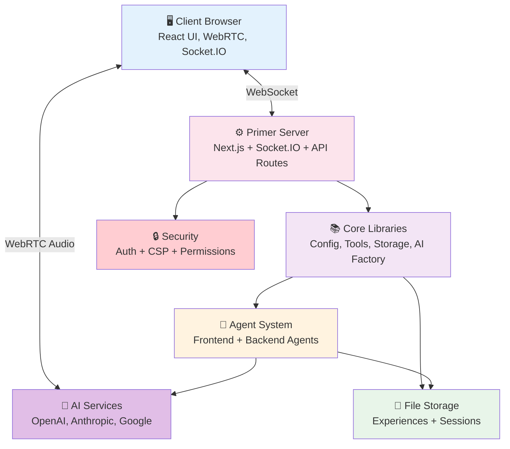
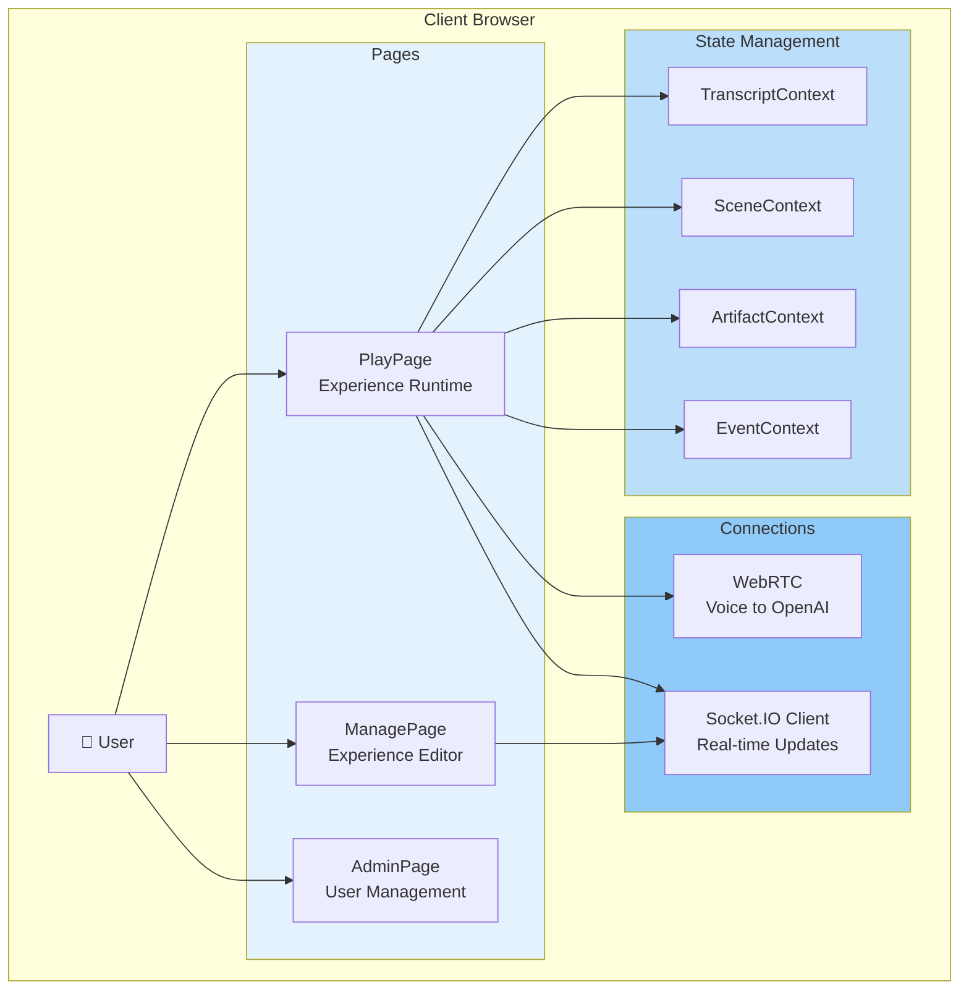
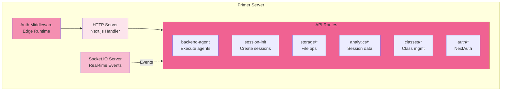
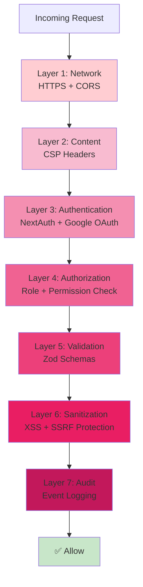
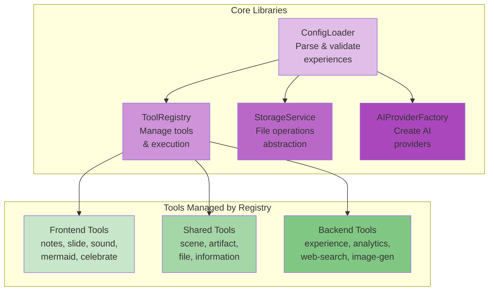
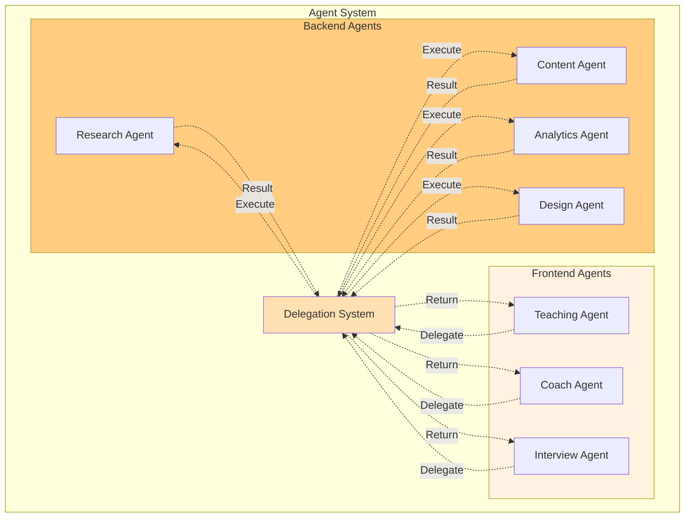
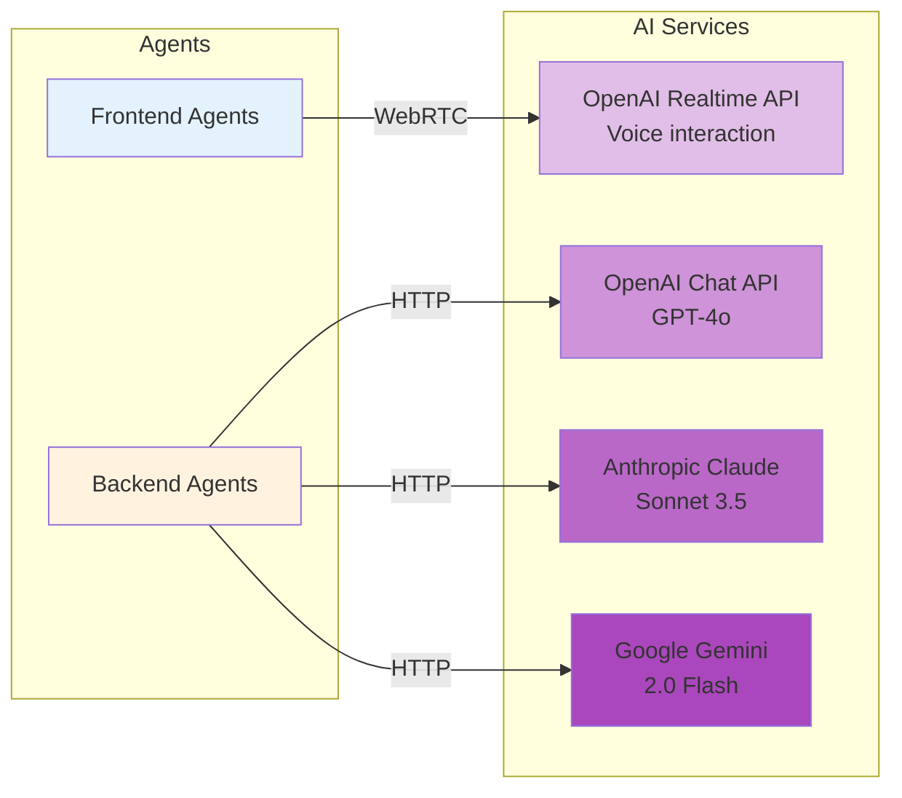
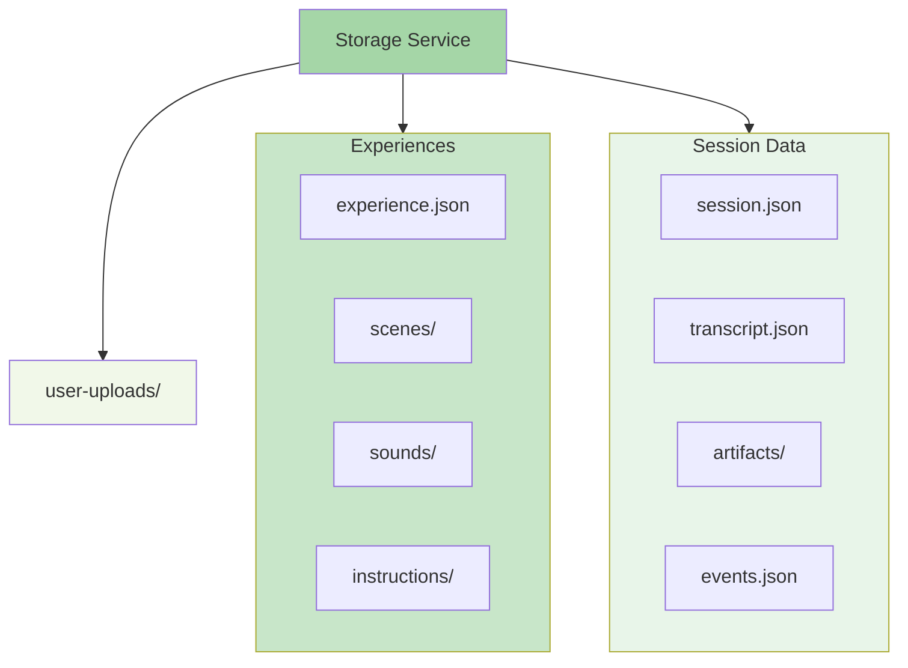

# System Overview: Visual Architecture

This document provides a **comprehensive visual walkthrough** of Primer's architecture using detailed diagrams. Each section breaks down a different layer of the system with mermaid diagrams showing how components interact.

**Best for**: Developers who want to see the system structure at a glance, understand component relationships, and reference architectural diagrams.

**For non-technical overview**: See [Understanding Primer](/user-guide/understanding-primer) for a plain-language explanation.

**For conceptual understanding**: See [Architecture Guide](./architecture-guide.md) for principles, tech stack, and design decisions.

---

## High-Level System Architecture

---

## Detailed Architecture by Section

### 1. Client Architecture

The client layer runs entirely in the student's web browser and handles all user-facing interactions.

**Key Responsibilities**:
- Render the user interface (PlayPage, ManagePage, AdminPage)
- Manage application state via React Contexts
- Establish WebRTC connection for voice interaction
- Maintain Socket.IO connection for real-time updates
- Execute frontend tools that manipulate the UI

**Technology**: React 19, Next.js 15 (client components), Socket.IO client, WebRTC APIs

**Read more**: [Components - Player Runtime](./components.md#8-player-runtime)

---

### 2. Server Architecture

The server layer is a custom Node.js server that integrates Next.js with Socket.IO for real-time capabilities.

**Key Responsibilities**:
- Handle HTTP requests via Next.js App Router
- Coordinate real-time events via Socket.IO
- Authenticate requests via Edge Runtime middleware
- Route API requests to appropriate handlers
- Manage in-memory session state

**Why Custom Server?**: Next.js doesn't natively support Socket.IO, so we use a custom server (server.ts) that wraps Next.js and adds WebSocket capabilities.

**Technology**: Node.js, Next.js 15 (App Router), Socket.IO v4.8, Express-like routing

**Read more**: [Components - Server Layer](./components.md#1-server-layer)

---

### 3. Security Layers

Security is implemented as seven defensive layers, each providing specific protections.

**Key Responsibilities**:
- **Layer 1 (Network)**: HTTPS enforcement, CORS protection
- **Layer 2 (Content)**: Content Security Policy headers, XSS prevention
- **Layer 3 (Authentication)**: NextAuth.js with Google OAuth
- **Layer 4 (Authorization)**: Role-based access control (admin/teacher/student)
- **Layer 5 (Validation)**: Zod schema validation, TypeScript type checking
- **Layer 6 (Sanitization)**: HTML sanitization, SSRF protection
- **Layer 7 (Audit)**: Event logging, security monitoring

**Defense in Depth**: Multiple layers mean that if one fails, others still protect users

**Why Google OAuth?**: Simplifies authentication, no password management, institutional accounts

**Technology**: NextAuth.js, Zod, DOMPurify, Pino logging

**Read more**: [Security & CSP](./security-csp.md), [Components - Security & Authentication](./components.md#12-security--authentication)

---

### 4. Core Libraries

Core libraries provide shared functionality used throughout the application, including the tools system that gives agents their capabilities.

**Key Responsibilities**:
- **ConfigLoader**: Parse and validate experience.json files, load instructions and resources
- **ToolRegistry**: Centralized tool registration, validation, and execution
- **StorageService**: Abstract file system operations for portability
- **AIProviderFactory**: Create AI provider instances (OpenAI, Anthropic, Google)

**Why Separate?**: These libraries are used by both frontend and backend code, so they're isolated from specific runtime contexts.

**Tools System**: The ToolRegistry manages 50+ tools organized into groups:
- **Frontend Tools**: UI manipulation (notes, slides, sounds, diagrams, celebrations)
- **Shared Tools**: Available to both (scenes, artifacts, files, information)
- **Backend Tools**: Processing (experience modification, analytics, web search, image generation)
- **Coordination Tools**: Agent collaboration (delegation, information sharing)

**Design Pattern**: Tools use command/action pattern (e.g., `scene.show`, `scene.hide`) to reduce complexity for AI agents.

**Technology**: TypeScript classes and services, Zod validation

**Read more**: [Tools System](./tools-system.md), [Components - Configuration System](./components.md#6-configuration-system)

---

### 5. Agent System

The dual-agent architecture is a key innovation separating real-time voice interaction from complex processing.

**Key Responsibilities**:
- **Frontend Agents**: Handle real-time voice conversation with students
- **Backend Agents**: Execute complex tasks (research, content generation, analytics)
- **Delegation System**: Coordinate handoff between frontend and backend agents

**Why Two Types?**:
- Frontend agents use OpenAI Realtime API for immediate voice responses
- Backend agents use Chat APIs for complex processing without interrupting conversation
- Backend agents have direct file access for better performance

**Flow**: Frontend agent delegates → Backend agent processes → Returns results → Frontend agent continues conversation

**Technology**: OpenAI Realtime API (frontend), OpenAI/Anthropic/Google Chat APIs (backend)

**Read more**: [Agent Architecture](./agent-architecture.md), [Delegation](./delegation.md)

---

### 6. AI Provider Integration

Primer supports multiple AI providers through an abstraction layer, allowing flexibility in choosing the best model for each task.

**Key Responsibilities**:
- Abstract provider-specific APIs into a common interface
- Support multiple providers simultaneously (different agents can use different providers)
- Handle provider-specific features (voice for OpenAI, long context for Claude)
- Manage API keys and configuration per provider

**Provider Choices**:
- **OpenAI Realtime API**: Required for frontend agents (voice interaction)
- **OpenAI Chat API**: Fast, reliable backend processing
- **Anthropic Claude**: Long context, complex reasoning
- **Google Gemini**: Cost-effective, fast processing

**Configuration**: Each experience defines AI configurations that agents reference

**Technology**: OpenAI SDK, Anthropic SDK, Google AI SDK

**Read more**: [AI Providers](./ai-providers.md), [Components - AI Provider Abstraction](./components.md#11-ai-provider-abstraction)

---

### 7. Storage Architecture

The storage system uses a file-based approach where each experience is a self-contained directory.

**Key Responsibilities**:
- Store experience configurations and resources
- Persist session data (transcripts, artifacts, events)
- Manage temporary user uploads
- Provide abstraction layer for future cloud storage support

**Directory Structure**:
- Each experience has its own directory (`storage/{experienceId}/`)
- Sessions are subdirectories within experiences
- User uploads are isolated per session
- Everything needed for an experience is in one place

**Benefits**:
- **Portability**: Zip an experience directory to share it
- **Clarity**: Clear boundaries between experiences
- **Simplicity**: No database setup required
- **Flexibility**: AI can create any file structure needed

**Future**: Storage abstraction allows for S3, Google Cloud Storage, or Azure Blob

**Technology**: Node.js fs module, file-based JSON storage

**Read more**: [Components - Storage System](./components.md#10-storage-system)

---

---

## How Components Interact

Each section works together to deliver AI-powered experiences:

| Component | Primary Role | Interacts With |
|-----------|-------------|----------------|
| **Client** | User interface, voice capture | Server (WebSocket), AI (WebRTC) |
| **Server** | Request routing, real-time coordination | All components |
| **Core Libraries** | Configuration, tools, storage abstraction | Server, Agents, Storage |
| **Agents** | AI-powered interactions | AI Providers, Tools, Storage |
| **AI Services** | Process requests, generate responses | Agents (via HTTP/WebRTC) |
