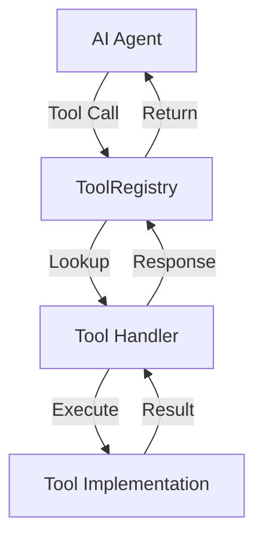
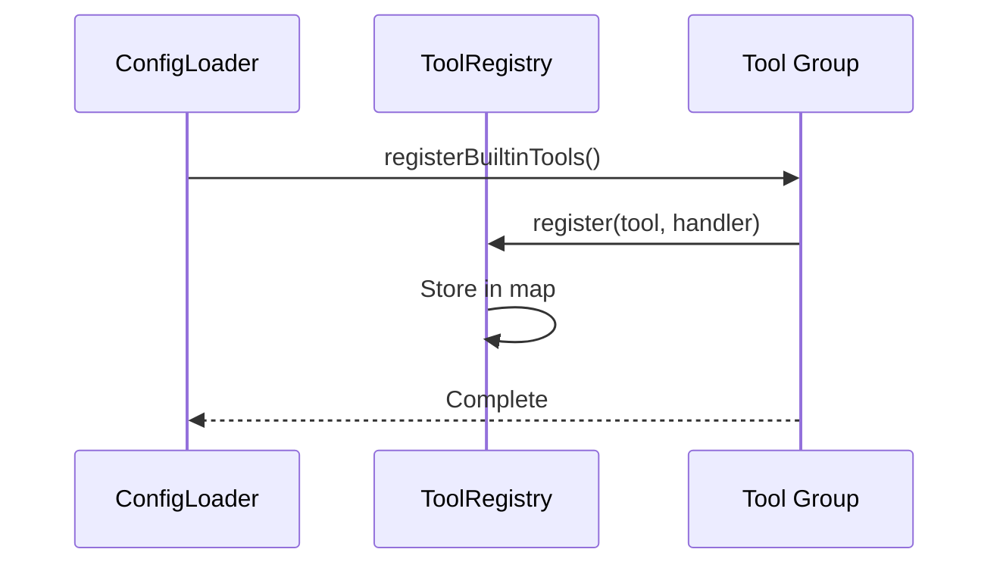
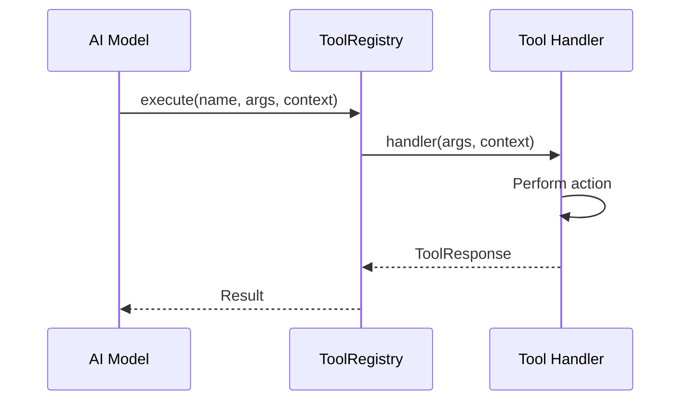

# Tools System

Tools are functions that AI agents can call to perform actions. All tools are centralized in `src/app/lib/tools/`.

## Architecture



### Key Components

| Component | Location | Purpose |
|-----------|----------|---------|
| **ToolRegistry** | `src/app/lib/ToolRegistry.ts` | Manages registration and execution |
| **Tool Groups** | `src/app/lib/tools/groups.ts` | Maps groups to tools |
| **Implementations** | `src/app/lib/tools/{group}/` | Actual tool code |

## Command/Action Pattern

Tools use a consolidated pattern with an `action` parameter:

```typescript
// Old pattern (deprecated)
discoverScenes()
setScene({ scene: 'intro' })

// New pattern
scene({ action: 'discover' })
scene({ action: 'set', scene: 'intro' })
```

**Benefits**:
- Fewer total tools
- Clearer for AI models
- Easier to document
- Consistent interface

## Tool Groups

### Frontend-Only

| Group | Tools | Purpose |
|-------|-------|---------|
| `notes` | note | Sticky note UI |
| `slide` | slide | Presentations |
| `mermaid` | diagram | Diagrams |
| `sound` | sound | Audio playback |
| `celebrate` | celebrate | Animations |
| `delegation` | delegate | Backend agent calls |

### Backend-Compatible

| Group | Tools | Purpose |
|-------|-------|---------|
| `builtin` | scene, information, file, artifact, agent | Core functionality |
| `experience` | File/directory operations | Experience management |
| `matter-compiler` | modifyExperience, modifyAgent, etc. | Config modification |
| `image-generator` | generateImage | AI image generation |
| `analytics` | Session analytics | Data analysis |
| `web-search` | research | Web search |

## Tool Context

Tools receive a context object with environment info:

### Frontend Context

```typescript
{
  experienceId: string;
  sessionId: string;
  availableScenes: Record<string, { path: string; url: string }>;
  availableSounds: Record<string, { path: string; url: string }>;
  getInformation: (key: string) => any;
  saveInformation: (key: string, value: any) => void;
  // UI-specific functions...
}
```

### Backend Context

```typescript
{
  experienceId: string;
  sessionId: string;
  delegationId?: string;
  userInfo?: { name: string; email: string };
  
  // Direct file system access
  listArtifacts: () => Promise<Artifact[]>;
  getArtifact: (id: string) => Promise<Artifact | null>;
  createArtifact: (name, content, type) => Promise<string>;
  updateArtifact: (id, content) => Promise<void>;
  deleteArtifact: (id) => Promise<void>;
  
  // Experience operations
  createFile: (expId, path, content) => Promise<void>;
  listResources: (expId) => Promise<string[]>;
  // ...
}
```

## Registration Flow



## Execution Flow



## Adding New Tools

### 1. Create Tool File

```typescript
// src/app/lib/tools/mygroup/mytool.ts
import { z } from 'zod';

export const myToolSchema = {
  name: 'myTool',
  description: 'Does something useful',
  parameters: z.object({
    action: z.enum(['do', 'undo']),
    value: z.string().optional(),
  }),
};

export async function myToolHandler(
  args: z.infer<typeof myToolSchema.parameters>,
  context: ToolContext
): Promise<ToolResponse> {
  if (args.action === 'do') {
    // Implementation
    return { status: 'success', data: result };
  }
  // ...
}
```

### 2. Export from Group

```typescript
// src/app/lib/tools/mygroup/index.ts
import { ToolRegistry } from '@/app/lib/ToolRegistry';
import { myToolSchema, myToolHandler } from './mytool';

export async function registerMyGroupTools() {
  const registry = ToolRegistry.getInstance();
  registry.register(myToolSchema, myToolHandler);
}
```

### 3. Add to Tool Groups

```typescript
// src/app/lib/tools/groups.ts
export const TOOL_GROUPS = {
  // ...
  mygroup: ['myTool'],
};
```

### 4. Use in Experience

```json
{
  "agents": {
    "my-agent": {
      "toolGroups": ["builtin", "mygroup"]
    }
  }
}
```

## Tool Response Format

```typescript
interface ToolResponse {
  status: 'success' | 'error' | 'deferred';
  data?: any;
  message?: string;
}
```

- **success**: Tool completed successfully
- **error**: Tool failed
- **deferred**: Tool started async operation

## Best Practices

### Design

1. **Use command/action pattern** for related functionality
2. **Validate inputs** with Zod schemas
3. **Return clear responses** with status and data
4. **Handle errors gracefully** with helpful messages
5. **Log operations** for debugging

### Implementation

1. **Keep tools focused** on single responsibility
2. **Use context** for environment access
3. **Avoid side effects** outside tool scope
4. **Test thoroughly** in both frontend and backend
5. **Document parameters** clearly

### Performance

1. **Minimize I/O** operations
2. **Cache when appropriate**
3. **Use async/await** for I/O
4. **Return quickly** for UI responsiveness
5. **Batch operations** when possible

## Debugging

Tools log with distinctive prefixes:

```
🔧 [CENTRALIZED TOOL] Executing: toolName
✅ [CENTRALIZED TOOL] toolName completed
❌ [CENTRALIZED TOOL] Error executing toolName
```

Enable debug logging in development.

## Common Tools Reference

### scene

```typescript
scene({ action: 'discover' })  // List available scenes
scene({ action: 'set', scene: 'classroom' })  // Change scene
scene({ action: 'describe' })  // Get current scene
```

### note

```typescript
note({ action: 'display', text: 'Hello', color: 'yellow' })
note({ action: 'hide', noteId: 'note-123' })
note({ action: 'list' })
```

### artifact

```typescript
artifact({ action: 'create', name: 'Summary', content: '...', type: 'markdown' })
artifact({ action: 'get', artifactId: 'art-123' })
artifact({ action: 'list' })
```

### delegate

```typescript
delegate({
  agentType: 'Design Agent',
  artifactIds: ['art-123'],
  taskDescription: 'Create design document'
})
```

## Next Steps

- [Delegation](/developer/architecture/delegation) - Agent coordination
- [Custom Tools Guide](/developer/guides/custom-tools) - Build your own
- [Experience Format](/developer/architecture/experience-format) - Configuration
