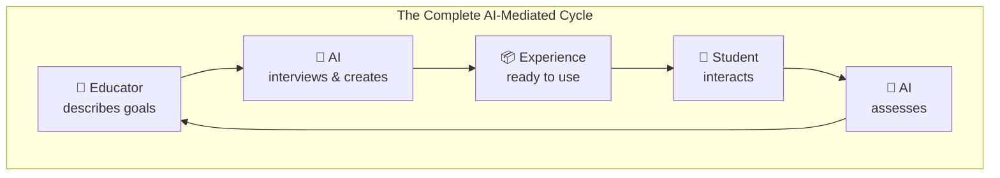

# Welcome to Primer

**Primer** is an AI-first platform for creating interactive educational experiences that combine voice, visuals, and autonomous AI agents. It enables a complete AI-mediated learning cycle—from experience design through student interaction to assessment.

## What Makes Primer Different

Primer is not a chatbot with features added. It is built from the ground up with AI as a first-class architectural element:

- **AI Creates Experiences** — Educators describe what they want; AI agents generate complete learning experiences
- **AI Teaches Students** — Voice-driven agents adapt in real-time to each student's needs
- **AI Assesses Learning** — Analytics agents analyze sessions and produce meaningful insights

## The AI-First Vision

Traditional educational software treats AI as a feature—an add-on to existing structures. Primer takes a fundamentally different approach:

> Software systems can be designed to accommodate AI not just as an external service, but as an active participant in the system's operation and evolution.

This means Primer provides "spaces" where AI agents operate with autonomy: designing curriculum, guiding learners, generating content, and evaluating outcomes. The platform enables AI without constraining what AI can do.

## What You'll Find Here

This documentation is organized into three main sections:

### 👤 [User Guide](/user-guide/overview)

Learn how to use Primer as an end user. Understand what Primer is, its key concepts, and how to interact with experiences.

**Perfect for:** Anyone wanting to understand what Primer does and how to use it.

### 💻 [Developer Documentation](/developer/overview)

Learn how to build with Primer. Comprehensive guides on architecture, creating experiences, and extending the platform.

**Perfect for:** Software engineers building experiences or contributing to Primer.

### 📚 [API Reference](/api/)

Auto-generated API documentation from the TypeScript source code.

**Perfect for:** Developers needing detailed API information.

## Quick Links

- **Getting Started**: Jump right in with our [User Guide](/user-guide/getting-started) or [Developer Setup](/developer/setup)
- **Architecture**: Learn about Primer's [design philosophy](/developer/architecture/philosophy) and [system overview](/developer/architecture/system-overview)
- **Key Concepts**: Understand [agents, tools, and experiences](/user-guide/key-concepts)
- **Contributing**: Want to contribute? Check out our [contributing guide](/developer/contributing)

## The Technology

Primer combines modern web technologies with state-of-the-art AI:

| Capability | Technology |
|------------|------------|
| **Voice Interaction** | OpenAI Realtime API (WebRTC) |
| **AI Processing** | OpenAI GPT-4, Anthropic Claude |
| **Image Generation** | OpenAI DALL-E, GPT Image |
| **Web Application** | Next.js 15, React 19, TypeScript |
| **Real-time Updates** | Socket.IO, WebSocket |
| **UI Components** | Tailwind CSS, Radix UI |

## Open Source

Primer is open source software licensed under the [Mozilla Public License 2.0](https://www.mozilla.org/en-US/MPL/2.0/). It is developed by the [Generative AI Lab](https://gail.wharton.upenn.edu/) at the Wharton School, University of Pennsylvania.

---

*Ready to explore? Start with [What is Primer?](/user-guide/what-is-primer) for a comprehensive introduction, or dive into the [System Overview](/developer/architecture/system-overview) to see how it all fits together.*
