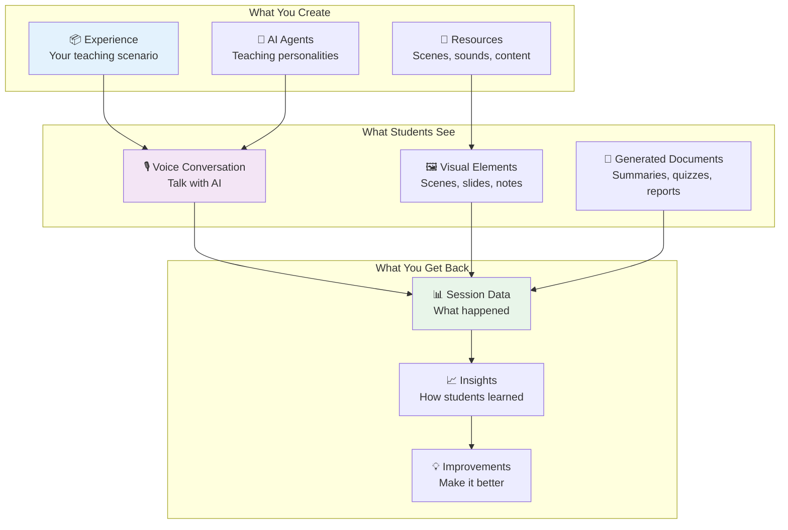
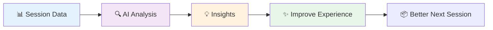
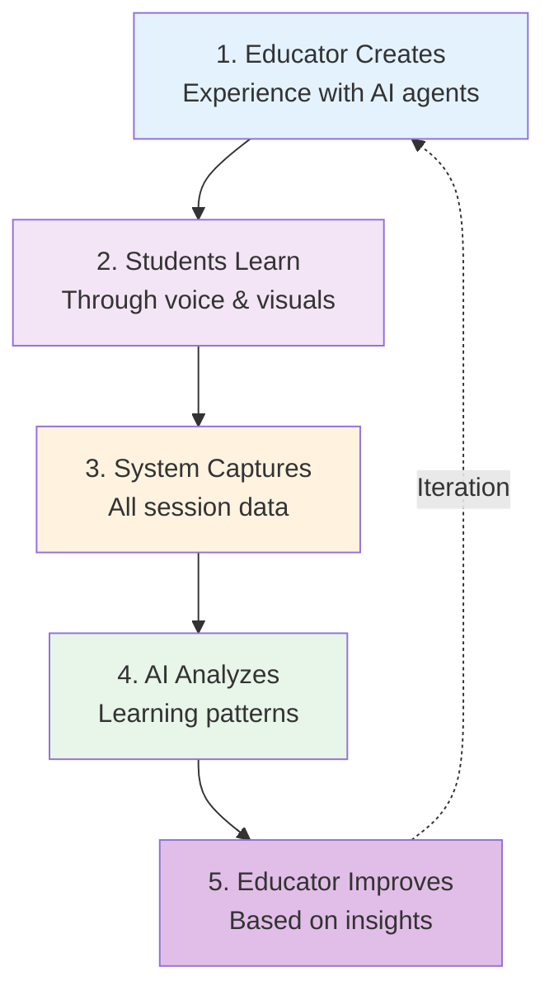

# Understanding Primer

This guide explains the big picture of how Primer works, focusing on three key areas: what you create, what students experience, and what you get back.

---

## The Big Picture

---

## 1️⃣ What You Create

As an educator, you create **Experiences** - complete, self-contained learning scenarios that combine everything needed for an interactive AI session.

### Experience Components

**📦 The Experience Package** contains:
- **Teaching scenario**: What the learning session is about
- **Learning objectives**: What students should achieve
- **Teaching guidelines**: How AI agents should teach

**🤖 AI Teaching Team** includes:
- **Lead teacher** (frontend agent): Talks with students via voice, maintains continuous engagement
- **Teaching assistants** (backend agents): Handle research, create materials, analyze progress behind the scenes

**🎨 Learning Environment** provides:
- **Scenes**: Background visuals that set the mood (forest scene for biology, office for business)
- **Sounds**: Ambient audio that creates atmosphere (birds chirping, city sounds)
- **Teaching materials**: Slides, diagrams, and resources ready to use

### Creating an Experience

Think of building an experience like preparing a complete lesson plan:

1. **Define your objectives**: What should students learn?
2. **Choose your AI teaching team**: Which agents will teach? What are their personalities?
3. **Set up the environment**: What scenes and sounds support the lesson?
4. **Configure capabilities**: What tools can agents use? (showing slides, creating quizzes, etc.)

**Example**: A "Photosynthesis Tutor" experience might include:
- A biology teacher AI agent with plant expertise
- A forest scene with nature sounds
- Ability to show diagrams, ask quiz questions, and generate study guides

---

## 2️⃣ What Students See

Students experience a multi-modal, interactive learning session that feels like having a conversation with a well-equipped tutor.

### Voice Conversation

**Natural dialogue** with AI:
- Students speak naturally using their microphone
- AI responds with realistic voice in real-time
- Conversation flows like talking to a tutor
- No typing required - fully hands-free learning

**Teaching adaptability**:
- AI adjusts explanations based on student responses
- Asks clarifying questions when students seem confused
- Provides encouragement and positive reinforcement
- Paces the lesson to match student understanding

### Visual Elements

**Dynamic learning environment**:
- **Scenes**: Background changes to match the topic (forest → lab → space)
- **Slides**: Presentation content appears at the right moments
- **Notes**: Key points highlighted as sticky notes
- **Diagrams**: Visual explanations generated on demand

**Teaching tools** the AI can use:
- Show and hide visual elements strategically
- Display multiple resources simultaneously
- Animate concepts for better understanding
- Celebrate student progress with visual feedback

### Generated Documents

**Real-time creation** during the session:
- **Study guides**: Summaries of what was covered
- **Quizzes**: Assessment questions based on the lesson
- **Reports**: Documentation of the learning session
- **Custom materials**: Anything the teaching scenario requires

**Persistence**: All generated materials are saved and available after the session ends.

---

## 3️⃣ What You Get Back

After each session, Primer captures comprehensive data and generates insights to help you understand student learning and improve experiences.

### Session Data

**Complete record** of what happened:
- **Transcript**: Everything said during the conversation
- **Artifacts**: All documents and materials created
- **Events**: Timeline of what tools were used when
- **Timing**: How long different activities took
- **Interactions**: Student engagement patterns

**Automatically captured** without any effort from you or the student.

### Analytics & Insights

**AI-powered analysis** of student learning:

**Individual Student Analysis**:
- Understanding level demonstrated
- Knowledge gaps identified
- Misconceptions detected
- Areas of strength and weakness
- Personalized feedback generated

**Cohort Analysis** (across multiple students):
- Common patterns and trends
- Topics where students struggle
- Successful teaching approaches
- Areas needing experience improvement

**Learning Patterns**:
- How students engage with different topics
- Which teaching strategies work best
- Optimal pacing and difficulty levels
- Effectiveness of visual aids and materials

### Continuous Improvement

**Feedback loop** for better experiences:

**What you learn**:
- Which explanations resonate with students
- Where to add more scaffolding
- What visuals enhance understanding
- How to adjust difficulty levels
- When to introduce new concepts

**How to improve**:
- Refine agent instructions based on patterns
- Add scenes/materials where students struggled
- Adjust pacing for different topics
- Create targeted interventions for common issues

---

## The Complete Cycle

**Continuous improvement**: Each session provides data that helps you refine and enhance the learning experience for future students.

---

## Why This Matters

**For Educators**:
- Create once, teach many times
- Get insights into student understanding
- Improve based on real data, not guesswork
- Scale personalized learning

**For Students**:
- Learn through natural conversation
- Visual and audio reinforce concepts
- Receive materials tailored to their needs
- Self-paced, adaptive learning

**For Learning Outcomes**:
- Better engagement through multi-modal interaction
- Deeper understanding through adaptive teaching
- Measurable progress through comprehensive data
- Continuous improvement of teaching effectiveness

---

## Next Steps

**Ready to start?**
- See [Key Concepts](/user-guide/key-concepts) for detailed definitions
- Try [Getting Started](/user-guide/getting-started) to launch your first experience
- Learn [How to Use Experiences](/user-guide/using-experiences) for interaction tips

**Want to create experiences?**
- Read [Creating Your First Experience](/developer/experiences/getting-started)
- Explore [Tools & Capabilities](/developer/architecture/tools-system) available to agents
- Understand [Agent Design](/developer/architecture/agent-architecture) principles

**Want technical details?**
- See [System Overview](/developer/architecture/system-overview) for architecture diagrams
- Review [Architecture Guide](/developer/architecture/architecture-guide) for design decisions
