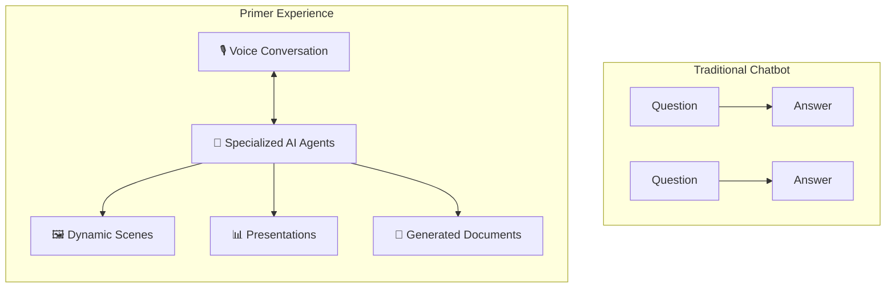
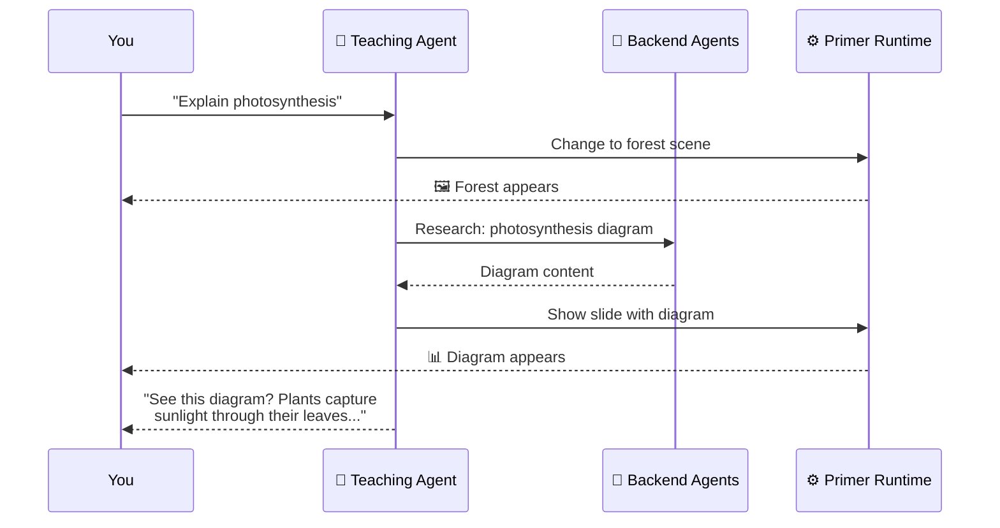

# What is Primer?

**Primer** is an AI-first platform for creating and delivering interactive educational experiences. It combines natural voice conversation, dynamic visuals, and autonomous AI agents to create learning environments that adapt to each student in real-time.

## Beyond Chatbots

While chatbots respond to prompts, Primer orchestrates complete learning journeys:

In Primer:
- AI agents **talk with you** using natural, realistic voice
- Agents **show you things** — scenes, diagrams, slides — as context for conversation
- Agents **create artifacts** — documents, reflections, assessments — as learning progresses
- Agents **delegate to specialists** — research assistants, image generators, assessors — working behind the scenes
- Everything **adapts in real-time** based on how you respond

## The Complete AI-Mediated Cycle

Primer enables a full cycle of AI-mediated education:

### 1. Educators Design (Through Conversation)

Instead of filling out forms or learning complex authoring tools, educators describe what they want in natural conversation with AI "intake agents." These agents understand pedagogy, ask probing questions, and synthesize the conversation into a complete learning experience.

### 2. AI Creates Experiences

Based on the interview, specialized AI agents generate:
- Learning content and explanations
- Assessment criteria and rubrics
- Visual assets and scene descriptions
- Agent prompts and behaviors

The result is a novel Experience — not a template filled with data, but an original creation tailored to the educator's specific goals.

### 3. Students Interact

Students launch the Experience and engage with AI teaching agents through:
- **Natural voice conversation** — Speak and listen like talking to a person
- **Visual context** — Backgrounds, scenes, and imagery that enhance understanding
- **Dynamic presentations** — Slides and diagrams that appear when relevant
- **Generated content** — Documents, reflections, and artifacts created on the fly

The AI agents pursue learning objectives adaptively, not through scripted paths but through intelligent responses to each student.

### 4. AI Assesses and Reports

After sessions complete, analytics AI agents:
- Analyze each student's transcript, artifacts, and behavioral signals
- Identify understanding demonstrated and gaps revealed
- Aggregate patterns across cohorts
- Generate reports for educators

This assessment works with unstructured data — AI finds what's meaningful, not just what was anticipated.

### 5. Iterate and Improve

Educators review analytics and refine experiences through further conversation with AI agents. The cycle continues, with each iteration improving the learning design.

## What Primer Enables

### For Educators

- **Describe, don't build** — Express learning goals in conversation; AI handles implementation
- **Rapid creation** — Complete experiences in hours, not weeks
- **Rich assessment** — AI-generated insights beyond multiple choice
- **Continuous improvement** — Refine based on actual student data

### For Students

- **Voice-first learning** — Natural conversation, not clicking through screens
- **Individualized attention** — AI adapts to each student's pace and understanding
- **Multi-modal experience** — Voice, visuals, and generated content working together
- **Active engagement** — Conversation, not passive consumption

### For Researchers

- **Experimental platform** — Test AI interaction hypotheses in controlled environments
- **Rich data** — Full transcripts, artifacts, and behavioral signals
- **Configurable agents** — Vary prompts, models, and behaviors systematically
- **Novel architectures** — Explore multi-agent coordination and AI-first design

## How It Actually Works

When you use Primer, here's what's happening:

1. **You speak** — Your voice is streamed to OpenAI's Realtime API
2. **The agent thinks** — AI processes what you said, considering its goals and context
3. **Tools are used** — The agent may change scenes, show slides, or delegate tasks
4. **Backend work happens** — Specialized agents handle complex requests
5. **You see and hear** — Visual changes appear; the agent responds in natural voice

All of this happens in real-time, creating a fluid conversational experience enhanced by visuals and generated content.

## Real-World Applications

### Education & Training

- **Interactive Tutoring** — AI tutors that explain, demonstrate, and assess understanding
- **Role-Play Practice** — Realistic scenarios for difficult conversations
- **Skill Development** — Guided practice with immediate, adaptive feedback
- **Assessment** — Rich evaluation beyond standardized tests

### Professional Development

- **Onboarding** — Personalized introduction to organizational knowledge
- **Interview Practice** — Realistic preparation with AI interviewers
- **Communication Training** — Practice presentations, negotiations, or client interactions
- **Compliance Training** — Interactive scenarios with documented completion

### Research

- **User Studies** — Controlled AI interaction experiments
- **Pedagogical Research** — Test teaching approaches at scale
- **AI Behavior Studies** — Systematic exploration of agent capabilities
- **Multi-Agent Systems** — Research agent coordination and delegation

## The Technology (Simplified)

| What | How |
|------|-----|
| **Voice Conversation** | OpenAI Realtime API streams audio both ways |
| **Visual Content** | React components render scenes, slides, notes |
| **AI Thinking** | GPT-4, Claude, and other models process context |
| **Backend Work** | Node.js server coordinates agents and tools |
| **Real-time Updates** | Socket.IO pushes changes to your browser |
| **Storage** | File-based system keeps experiences and session data |

You don't need to understand any of this to use Primer — it all works seamlessly behind the scenes.

## What Primer Is Not

- **Not a simple chatbot** — Multiple agents, multiple modalities, complex orchestration
- **Not pre-scripted** — AI determines responses based on goals, not decision trees
- **Not template-based** — Experiences are generated, not assembled from pieces
- **Not surveillance** — Analytics serve learning, not monitoring
- **Not a replacement for teachers** — AI augments educators; it doesn't replace them

## Get Started

Ready to try it?

- **Students**: Head to [Getting Started](/user-guide/getting-started) to run your first experience
- **Educators**: Explore [Key Concepts](/user-guide/key-concepts) to understand how experiences work
- **Developers**: Jump to [Developer Overview](/developer/overview) to build and extend

---

*Primer is open source under the Mozilla Public License 2.0. Developed by the Generative AI Lab at the Wharton School, University of Pennsylvania.*
