# Diagram 1: Experience Creation Flow

## The Conversation-Driven Creation Process

```mermaid
flowchart TB
    classDef educator fill:#2d3748,stroke:#e2e8f0,color:#e2e8f0,stroke-width:2px
    classDef frontend fill:#3182ce,stroke:#bee3f8,color:#fff,stroke-width:1px
    classDef backend fill:#805ad5,stroke:#d6bcfa,color:#fff,stroke-width:1px
    classDef artifact fill:#d69e2e,stroke:#fefcbf,color:#1a202c,stroke-width:1px
    classDef tool fill:#38a169,stroke:#c6f6d5,color:#fff,stroke-width:1px
    classDef output fill:#e53e3e,stroke:#fed7d7,color:#fff,stroke-width:2px

    subgraph INTERVIEW["① Intake Interview (Voice Conversation)"]
        direction TB
        EDU[/"👤 Educator"/]:::educator
        IA["Intake Agent\n(Front-End, Voice)"]:::frontend
        
        EDU <-->|"Real-time voice\nconversation"| IA
        
        IA -->|"Asks about topic,\nlearning objectives,\nstudent level"| Q1["Lesson & Objectives"]:::artifact
        IA -->|"Asks about prior knowledge,\nmisconceptions,\nassessment criteria"| Q2["Teaching Context"]:::artifact
        IA -->|"Requests & reads\nuploaded materials"| Q3["Educator Materials\n(PDFs, lesson plans)"]:::artifact
        IA -->|"Conducts web research\n(AP curricula, standards)"| Q4["Research Notes"]:::artifact
        IA -->|"Selects template type\n(Roleplay or Teachback)"| Q5["Template Selection"]:::artifact
        IA -->|"Proposes game flow,\ngets educator buy-in"| Q6["Agreed Concept"]:::artifact
    end

    subgraph JOURNAL["Living Documents"]
        direction TB
        J1["📓 Intake Journal\n(Agent's private notes:\ngoals, observations,\nstrategic decisions)"]:::artifact
        CL["☑ Intake Checklist\n(Tracks progress through\ninterview phases)"]:::artifact
        CT["📝 Conversation Transcript\n(Full verbatim record\nof the interview)"]:::artifact
    end

    INTERVIEW --> JOURNAL

    subgraph DESIGN["② Design Agent (Backend, Non-Interactive)"]
        direction TB
        DA["Design Agent"]:::backend
        DA -->|"Analyzes transcript\n& educator materials"| DD
        DD["📄 Design Document\n─────────────────\n• Overview & template type\n• Learning objectives\n• Three-scene narrative\n• Character context blocks\n  (Mentor / Practice / Feedback)\n• Stakes & adaptations\n• Assessment criteria"]:::artifact
    end

    JOURNAL -->|"Transcript +\nmaterial artifact IDs\npassed via delegate tool"| DESIGN

    subgraph REVIEW["③ Educator Review"]
        direction TB
        IA2["Intake Agent\npresents design\non a slide"]:::frontend
        EDU2[/"👤 Educator\nreviews & approves\n(or requests changes)"/]:::educator
        IA2 <-->|"Voice discussion\nof design document"| EDU2
    end

    DESIGN -->|"Design document\nartifact ID returned"| REVIEW

    subgraph CASTING["④ Casting Director (Backend)"]
        direction TB
        CD["Casting Director"]:::backend
        CD -->|"Loads template\nagent prompts"| TP["Template\nPrompts"]:::tool
        CD -->|"Integrates character\ncontext from design doc"| CP["3 Customized\nAgent Prompts\n(Mentor, Practice,\nFeedback)"]:::artifact
    end

    REVIEW -->|"Approved design\ndoc artifact ID"| CASTING

    subgraph IMAGES["⑤ Image Generation Agent (Backend)"]
        direction TB
        IG["Image Generation\nAgent"]:::backend
        IG -->|"Chooses visual style\n& generates 3 scenes"| SC["🎨 Scene Images\n(Mentor, Practice,\nFeedback backdrops)"]:::artifact
    end

    CASTING -->|"Prompt artifact IDs\n+ design doc"| IMAGES

    subgraph BUILD["⑥ Experience Builder (Backend)"]
        direction TB
        EB["Experience Builder"]:::backend
        EB -->|"Copies template,\ndeploys artifacts,\nconfigures voices,\nsets metadata"| EXP["🎮 Complete\nPlayable Experience"]:::output
    end

    IMAGES -->|"All artifact IDs\n(prompts + images)"| BUILD

    BUILD -->|"Experience ID\nreturned to\nIntake Agent"| FINAL

    subgraph FINAL["⑦ Delivery"]
        direction TB
        IA3["Intake Agent presents\nlink to new Experience"]:::frontend
        EDU3[/"👤 Educator\ncan test it immediately"/]:::educator
        IA3 --> EDU3
    end
```

## Annotation

The creation of a Primer Experience is a conversation-first process. An educator speaks naturally with the **Intake Agent** — a voice-based AI running in the browser via the OpenAI Realtime API. There are no forms to fill out. The Intake Agent follows an internal checklist and maintains a private journal of observations and strategic decisions as the conversation progresses. It asks about the lesson topic, learning objectives, student level, prior knowledge, assessment criteria, and teaching challenges — one question at a time, adapting its line of inquiry based on each response.

The educator can upload supporting materials (lesson plans, syllabi, rubrics) at any point, and the Intake Agent can conduct web research to ground its understanding in published curricula and standards. Based on the conversation, the Intake Agent selects a **template type** — currently Roleplay (for interpersonal skill practice) or Teachback (for knowledge demonstration) — and proposes a general experience flow for the educator's approval.

Once the concept is agreed upon, the Intake Agent orchestrates a pipeline of four specialized **backend agents**, each performing a discrete task. The **Design Agent** transforms the full conversation transcript into a structured design document with character context blocks, narrative arcs, and assessment criteria. This document returns to the Intake Agent, which presents it to the educator for review and approval. The **Casting Director** then takes the approved design and integrates its character descriptions into template agent prompts — preserving the template's pedagogical scaffolding while bringing characters to life with specific voices, personalities, and behavioral tactics. The **Image Generation Agent** creates three scene backdrops (one per phase) in a cohesive visual style. Finally, the **Experience Builder** assembles everything — copying a template, deploying the customized prompts and images, configuring agent voices, and publishing the experience to the catalog. The educator receives a link and can immediately test the result.

Throughout this pipeline, all inter-agent communication happens via **artifacts** — named, versioned files stored in the session directory. Each agent receives artifact IDs through the delegation mechanism and returns new artifact IDs in its response, creating a traceable chain of provenance from the initial conversation to the final playable experience.
