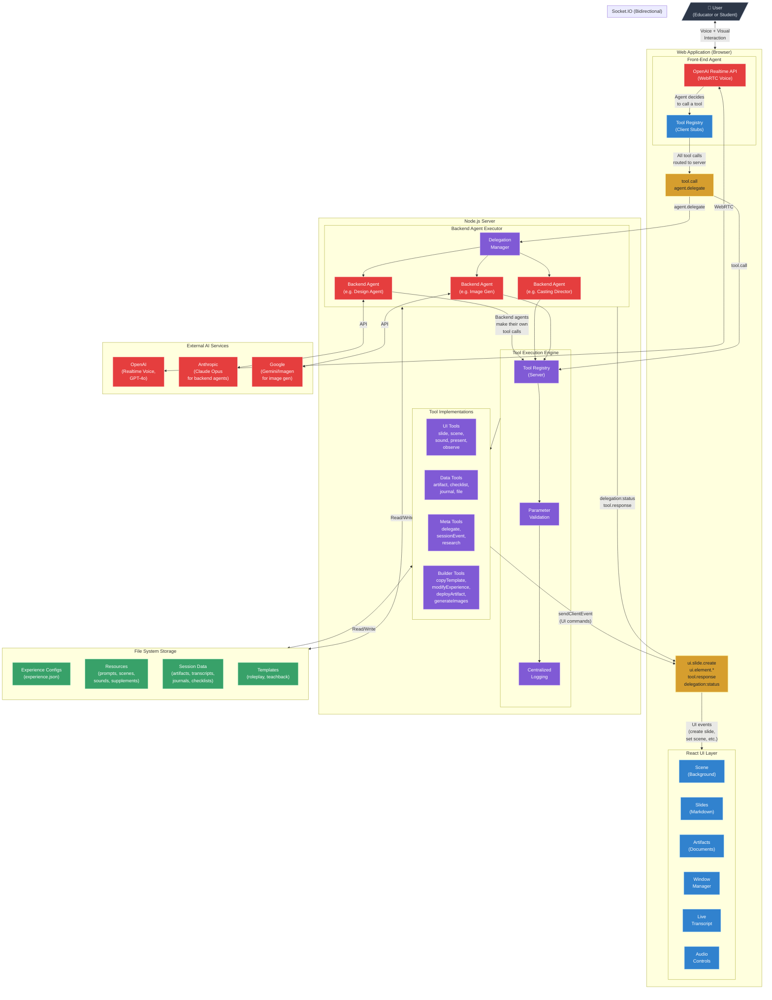

# Diagram 2: System Architecture

## How the Pieces Fit Together

## Annotation

Primer's architecture follows a **backend-first** pattern: every tool call — whether initiated by a front-end voice agent running in the browser or a backend agent running on the server — is executed on the server. This seemingly redundant round-trip for front-end agents is intentional: it creates a single code path for all tool execution, enabling centralized logging, validation, authorization, and a unified programming model.

The **front-end agent** connects to the OpenAI Realtime API via WebRTC for low-latency voice conversation. When the agent decides to call a tool (show a slide, set a scene, create an artifact), the call is intercepted by a client-side **tool stub** that serializes it and sends it to the server over **Socket.IO**. The server's **Tool Registry** validates parameters, logs the invocation, and executes the tool implementation. If the tool has a UI effect (e.g., creating a slide), the server emits a socket event back to the browser, where a React event handler creates the corresponding component and registers it with the **UIElementManager** — a singleton that tracks all on-screen elements (position, size, visibility, z-index). The browser then sends a confirmation back to the server, which completes the tool call and returns the result to the agent.

**Backend agents** are invoked through the **delegate** tool. When the front-end agent delegates a task, the server spawns a backend agent execution context with full socket awareness — meaning backend agents can trigger UI changes on the educator's screen in real time (showing progress overlays, status updates, even creating slides). Backend agents use different AI providers depending on their task: Anthropic Claude for instruction-following tasks (design, casting, building), and Google Gemini for image generation. Each backend agent has access to the same tool registry and can make its own tool calls, including reading and writing artifacts to the file system.

The **storage layer** is file-system-based. Each experience is a directory containing an `experience.json` configuration file, resource directories for agent prompts, supplemental instructions, scene images, and sounds. Session data — artifacts, transcripts, journals, checklists — is stored per-session within the experience directory. Templates are special experiences marked with `kind: "template"` that serve as the structural foundation for new experiences created by the Experience Builder.
