# Diagram 3: Anatomy of an Experience

## What's Inside a Primer Experience

```mermaid
block-beta
    columns 3

    block:HEADER:3
        columns 3
        H["🎮 Experience: 'The Town Hall — Win Over a Skeptical Crowd'"]
        V["v1.0.7"]
        META["kind: experience | author: Lilach Mollick"]
    end

    space:3

    block:CONFIG:3
        columns 1
        C_TITLE["⚙️ AI Configurations"]
        C1["voice-interactive: OpenAI Realtime (gpt-realtime) — audio + text, streaming"]
        C2["analytics: Anthropic Claude Opus — text only, non-streaming"]
    end

    space:3

    block:AGENTS:3
        columns 3
        A_TITLE["🤖 Agents (Sequential Flow)"]:3
        
        block:MENTOR:1
            columns 1
            M_NAME["Mentor Agent"]
            M_TYPE["type: frontend (voice)"]
            M_VOICE["voice: marin"]
            M_NEXT["→ hands off to Practice"]
        end

        block:PRACTICE:1
            columns 1
            P_NAME["Practice Agent"]
            P_TYPE["type: frontend (voice)"]
            P_VOICE["voice: shimmer"]
            P_NEXT["→ hands off to Feedback"]
        end

        block:FEEDBACK:1
            columns 1
            F_NAME["Feedback Agent"]
            F_TYPE["type: frontend (voice)"]
            F_VOICE["voice: marin"]
            F_NEXT["→ session ends"]
        end
    end

    space:3

    block:ANALYTICS:3
        columns 2
        AN_TITLE["📊 Analytics Agents"]:2
        
        block:SR:1
            columns 1
            SR_NAME["Student Report Agent"]
            SR_TYPE["type: backend"]
            SR_DESC["Per-student performance analysis"]
        end

        block:CA:1
            columns 1
            CA_NAME["Class Analytics Agent"]
            CA_TYPE["type: backend (depends on Student Report)"]
            CA_DESC["Aggregate class-level insights"]
        end
    end

    space:3

    block:RESOURCES:3
        columns 3
        R_TITLE["📁 Resources"]:3
        
        block:INSTR:1
            columns 1
            I_TITLE["Instructions"]
            I1["Agent Prompts\nmentor.md\npractice.md\nfeedback.md\nstudent_report.md\nclass_analytics.md"]
            I2["Supplemental\nagent.md (shared context)\ntools.md (tool guidance)\nscene.md (scene control)\njournal.md (journaling)\nchecklists.md\nerror-handling.md\nsecurity.md"]
        end

        block:VISUAL:1
            columns 1
            V_TITLE["Scenes & Sounds"]
            V1["🖼️ Scenes\nmentor-scene.png\npractice-scene.png\nfeedback-scene.png"]
            V2["🔊 Sounds\nconfirmation_1.mp3\nconfirmation_2.mp3\nerror_1.mp3"]
        end

        block:ARTS:1
            columns 1
            A_TITLE2["Artifacts & Components"]
            A1["📋 Artifacts\n(Pre-loaded checklists,\nreference documents)"]
            A2["🧩 Components\n(Custom React UI —\nfuture capability)"]
        end
    end

    space:3

    block:TOOLSETS:3
        columns 1
        T_TITLE["🔧 Toolsets"]
        T_DESC["Named collections of tools available to agents. Each agent references a toolset."]
        T1["default (front-end agents): slide, scene, sound, artifact, checklist, delegate, present, observe, research, file, sessionEvent, toast, celebrate"]
    end

    style HEADER fill:#2d3748,color:#e2e8f0,stroke:#e2e8f0
    style CONFIG fill:#3182ce,color:#fff,stroke:#bee3f8
    style AGENTS fill:#805ad5,color:#fff,stroke:#d6bcfa
    style MENTOR fill:#6b46c1,color:#fff,stroke:#d6bcfa
    style PRACTICE fill:#6b46c1,color:#fff,stroke:#d6bcfa
    style FEEDBACK fill:#6b46c1,color:#fff,stroke:#d6bcfa
    style ANALYTICS fill:#38a169,color:#fff,stroke:#c6f6d5
    style SR fill:#2f855a,color:#fff,stroke:#c6f6d5
    style CA fill:#2f855a,color:#fff,stroke:#c6f6d5
    style RESOURCES fill:#d69e2e,color:#1a202c,stroke:#fefcbf
    style INSTR fill:#b7791f,color:#fff,stroke:#fefcbf
    style VISUAL fill:#b7791f,color:#fff,stroke:#fefcbf
    style ARTS fill:#b7791f,color:#fff,stroke:#fefcbf
    style TOOLSETS fill:#e53e3e,color:#fff,stroke:#fed7d7
```

### Alternate View: Layer Diagram

```mermaid
graph TB
    classDef layer1 fill:#2d3748,stroke:#e2e8f0,color:#e2e8f0,stroke-width:2px
    classDef layer2 fill:#3182ce,stroke:#bee3f8,color:#fff,stroke-width:1px
    classDef layer3 fill:#805ad5,stroke:#d6bcfa,color:#fff,stroke-width:1px
    classDef layer4 fill:#d69e2e,stroke:#fefcbf,color:#1a202c,stroke-width:1px
    classDef layer5 fill:#38a169,stroke:#c6f6d5,color:#fff,stroke-width:1px
    classDef layer6 fill:#e53e3e,stroke:#fed7d7,color:#fff,stroke-width:1px
    classDef note fill:none,stroke:none,color:#718096

    subgraph L1["experience.json — Identity & Configuration"]
        direction LR
        ID["Title, Description,\nVersion, Author"]
        AI["AI Configurations\n(provider, model,\nmodalities per role)"]
    end

    subgraph L2["Agents — The Cast"]
        direction LR
        A_FLOW["Sequential Flow:\nmentor → practice → feedback"]
        A_PROPS["Per Agent:\nname, voice, type,\nAI config, toolset,\ndownstream agents"]
        A_AN["Analytics Agents:\nstudentReport,\nclassAnalytics\n(backend, non-interactive)"]
    end

    subgraph L3["Instructions — The Scripts"]
        direction LR
        PROMPTS["Agent Prompts\n(one .md file per agent:\npersonality, goals,\nbehavior, checklist)"]
        SUPPL["Supplemental Instructions\n(shared across agents:\ntool usage, journaling,\nerror handling, security)"]
        SUPPL_NOTE["Prompts use mustache-style\nplaceholders like ｛｛tools｝｝\nthat resolve to supplemental\nfiles at runtime"]
    end

    subgraph L4["Resources — The Stage"]
        direction LR
        SCENES["Scene Images\n(AI-generated backdrops,\none per phase)"]
        SOUNDS["Sound Effects\n(confirmation, error,\ncelebration)"]
        ARTIF["Pre-loaded Artifacts\n(checklists, reference\ndocuments for agents)"]
    end

    subgraph L5["Toolsets — The Capabilities"]
        direction LR
        TS_DEF["Named tool collections\nassigned to agents"]
        TS_EX["Examples:\nslide, scene, sound,\npresent, observe,\nartifact, delegate,\nresearch, checklist,\nsessionEvent"]
    end

    L1 --> L2 --> L3 --> L4 --> L5

    L1:::layer1
    L2:::layer3
    L3:::layer2
    L4:::layer4
    L5:::layer6

    style L1 fill:#2d3748,color:#e2e8f0,stroke:#e2e8f0
    style L2 fill:#805ad5,color:#fff,stroke:#d6bcfa
    style L3 fill:#3182ce,color:#fff,stroke:#bee3f8
    style L4 fill:#d69e2e,color:#1a202c,stroke:#fefcbf
    style L5 fill:#e53e3e,color:#fff,stroke:#fed7d7
```

## Annotation

A Primer **Experience** is a self-contained directory that fully describes an AI-driven learning session. At its core is `experience.json` — a configuration file that defines everything the runtime needs to load and execute the experience. No code changes are required to create a new experience; the entire definition is declarative.

The configuration is organized into several layers. The **identity layer** includes the title, description, version, and author metadata. The **AI configurations** layer defines named provider profiles — for example, `voice-interactive` maps to the OpenAI Realtime API for voice conversation, while `analytics` maps to Anthropic Claude for backend report generation. Each agent references one of these configurations, decoupling the agent's role from its underlying model.

The **agents layer** defines the cast of characters. In the current templates, three front-end agents form a sequential flow: the **Mentor** introduces concepts and prepares the student, the **Practice Agent** facilitates the core learning activity (playing a counterpart in Roleplay, or a curious learner in Teachback), and the **Feedback Agent** evaluates performance. Each agent has a distinct voice, personality, and set of downstream handoff targets. Additionally, two **analytics agents** (Student Report and Class Analytics) run as backend processes after the session ends, generating performance reports from the unstructured session data.

The **instructions layer** contains the actual prompts — one markdown file per agent, plus shared **supplemental instructions** that cover tool usage, journaling protocols, error handling, and security guidelines. Agent prompts use mustache-style placeholders (e.g., `{{tools}}`, `{{scene}}`) that the runtime resolves by injecting the corresponding supplemental file content. This separation allows the same pedagogical scaffolding to be shared across all agents while each agent's core prompt remains focused on its unique role.

The **resources layer** holds the sensory assets: AI-generated scene images (one per phase), sound effects for feedback moments, and pre-loaded artifacts like checklists that agents use during the session. Finally, **toolsets** are named collections of tools (slide, scene, sound, artifact, delegate, observe, present, etc.) that determine what capabilities each agent has access to. This layered, declarative structure means that the entire experience — from the AI models used, to the characters' personalities, to the visual atmosphere — is defined in configuration, not code.
