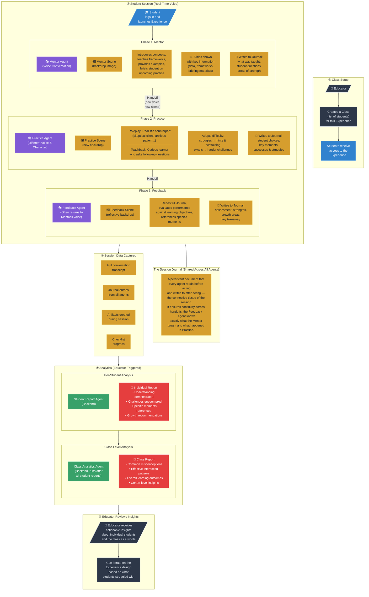

# Diagram 4: The Student Experience

## From Class Enrollment to Analytics

## Annotation

The student experience begins before the student ever speaks a word. The **educator creates a class** — a roster of students assigned to a specific Experience. Students receive access, log in, and launch the Experience from a catalog.

The session itself is a **real-time voice conversation** with a sequence of AI agents, each occupying a distinct phase. The student speaks into their microphone and hears the AI respond with an expressive, realistic voice — not text-to-speech but the OpenAI Realtime API's native voice synthesis. A live transcript sidebar shows the conversation as it unfolds, and visual elements — scene backdrops, informational slides, reference documents — appear in draggable, resizable windows that the student can arrange.

The **Mentor Agent** opens the session, setting the scene (literally — a background image appears), introducing key concepts, teaching frameworks with concrete examples, and briefing the student on the upcoming practice challenge. Information-dense content is presented on slides rather than spoken at length. When the student is ready, the Mentor hands off to the **Practice Agent**, which arrives with a different voice and a new scene backdrop — a deliberate sensory signal that the dynamic has shifted. In a Roleplay experience, the Practice Agent embodies a realistic counterpart (a skeptical journalist, a difficult client, an anxious patient) and stays in character throughout. In a Teachback experience, it plays a curious learner who asks probing follow-up questions. The agent adapts in real time: if the student struggles, it offers scaffolding; if the student excels, it escalates the challenge. After practice, the **Feedback Agent** — often returning to the Mentor's voice — reads the full session journal and delivers a targeted evaluation, referencing specific moments from the practice session and connecting them to the learning objectives.

The **session journal** is the critical connective tissue. It is a persistent document that every agent reads before acting and writes to after acting. The Mentor records what was taught; the Practice Agent logs what happened; the Feedback Agent synthesizes it all into an assessment. This shared memory is what makes the three-agent handoff feel like a coherent experience rather than three disconnected conversations.

After the session, all data — transcripts, journal entries, artifacts, checklist progress — is stored in the session directory. When the educator is ready, they can trigger **analytics agents**: the **Student Report Agent** analyzes each individual session, producing a report that references specific moments and identifies strengths and growth areas. The **Class Analytics Agent** then aggregates across all student reports, surfacing common misconceptions, effective interaction patterns, and cohort-level insights. Both analytics agents are fully customizable — their prompts are part of the experience definition, meaning the educator (or the meta-experience that created the experience) controls exactly what is assessed and how. The educator receives these reports and can use them to iterate on the Experience design, closing the loop from creation to delivery to insight.
